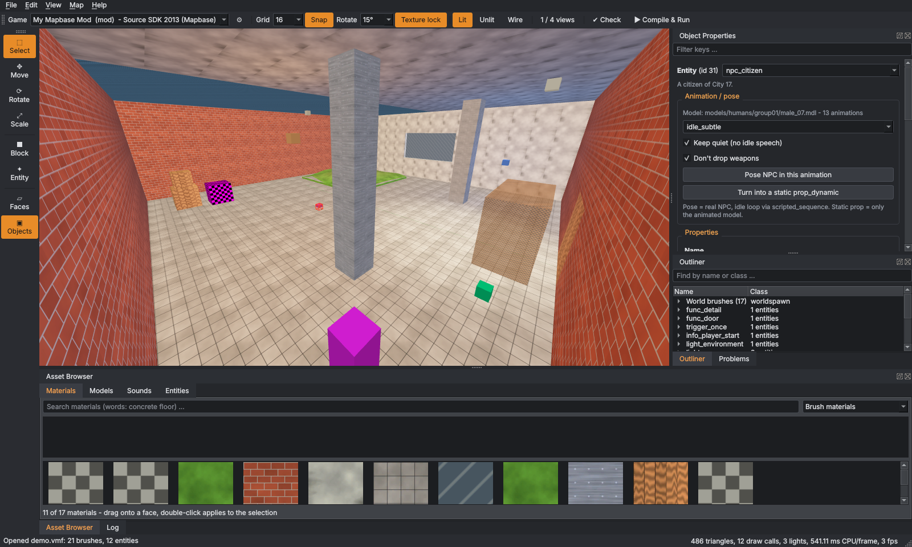
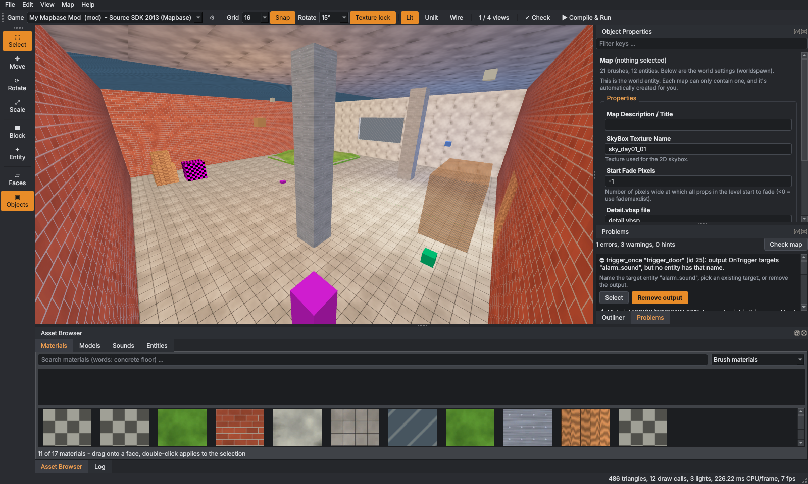

# Source Map Editor (hammer-test)

A modern, 3D-first map editor for **Source 1** games — Half-Life 2, Mapbase mods, Black Mesa and other Source games —
that works like **Source 2 Hammer** but saves ordinary `.vmf` files for the normal compile tools (VBSP, VVIS, VRAD).

It started as an experiment: how far can an AI-built editor go? This is the first usable iteration.



## What it can do

- **Finds your games and mods by itself**: every Source 1 game in your Steam libraries and every mod in
  `steamapps/sourcemods` (Mapbase mods included), shown with clear names and grouped by game, with a search field.
  FGDs and compile tools are taken from your Hammer/Hammer++ setup; Mapbase mods also get Mapbase's FGD, so entities
  like `env_global_light` are there. Folders that are only content of another game (like `hl2` inside Entropy : Zero 2)
  are marked "base content" and listed last.
- **3D view first**, like Source 2 Hammer: look around with the right mouse button and fly with W A S D (also while
  placing a block), orbit with Alt, gizmos to move/rotate/scale, Shift+drag to copy. Optional 2D views (top/front/side).
  The menu in the top left corner of each view switches between 3D, top, front and side, and between lighting preview,
  textured and wireframe. Its **Show** section (also View > Show) hides kinds of objects while you map: world brushes,
  brush entities, triggers, tool brushes and faces (clip, nodraw, hint …), sky brushes, models, NPCs, lights, cubemaps
  and other entities. The view's button says how many kinds are hidden.
- **Snap to corners**: the move tool shows small squares on the corners of the selection; drag one onto a corner of
  another brush or model and they line up exactly.
- **Resize right away**: selected brushes show squares on their sides in the select tool too; drag one to make the
  brush longer, shorter or taller without switching to the scale tool.
- **Lighting preview with real-time shadows** from your light entities (light, light_spot, light_environment), using
  VRAD's own falloff formulas: the sun and the nearest spot and point lights cast shadows (F7 turns them off).
  Entities show their editor icons (the sprites and models Hammer uses).
- **Models**: props and NPCs are drawn with their real model and textures. The model browser shows a preview of every
  model; drag one into the 3D view to place it as a prop_static.
- **Shapes**: the block tool makes blocks, wedges, cylinders, spikes (pyramids, cones), spheres, arches (rings and
  spirals) and stairs. Change the settings in the **Tool** panel right after creating a shape and it is rebuilt.
  Click or press Enter to create a block and simply drag on for the next one.
- **Brush tools** (right-click menu or the **Brushes** menu): hollow (wall thickness, walls inside or outside), carve,
  merge into one brush, round or bevel the edge between two faces, drop to floor, select a whole path_track chain.
- **Clip, vertex and polygon tools**: cut brushes with a line (2D view) or three points (3D view); drag corners and edge
  middles (brushes always stay convex); draw a brush from the corners of its base.
- **Entity tool**: the Tool panel on the left lists every point and brush entity with its icon (search with words like
  "global light", A–Z or in groups). The class you pick is *armed*: the next click places it on the surface under the
  cursor (a preview of it follows the mouse); a brush entity (trigger, door, …) is built from the next box you drag.
  **Random yaw** turns every new prop differently.
- **Smart properties for every entity**: the class at the top (pick another class to change it, the keys stay), then
  the tabs **Keyvalues**, **Outputs** and **Inputs** with their counts. Keys are grouped by where the FGD defines them
  (Targetname, Angles, the entity's own class, Flags, Placement); click a group's title to fold it away. Each key has
  a fitting editor (lists, yes/no and flags as switches, colors, targets, models, animations, sounds, particle
  systems); what the key you are in does is shown at the bottom of the panel. *Find a property or flag* filters
  keys and flags. Outputs are edited as readable cards ("When OnTrigger tell door_01 to Open") with drop-downs for the
  target's inputs; Inputs lists the entities that send something to this one, with *Go to*. Every entity has a Name
  field. Turn **Smart Edit** off to see every key as plain text, like Hammer; add any key with the
  *new key | value | + Add* row.
- **Sky and map settings**: with nothing selected (or **Map > Map properties**) the panel shows the world's keys; the
  sky is picked from the game's skies, each with a small picture.
- **Copy and paste objects**: Ctrl+C / Ctrl+X copies or cuts the selected brushes and entities, Ctrl+V pastes them
  under the mouse (resting on the surface). **Paste special** (Ctrl+Shift+V) makes several copies at once, each moved
  and turned a step further, and gives entity names a number (door → door_2) so the copies' outputs stay their own.
  Copied objects are VMF text, so they also paste into another map.
- **Copy and paste names**: Ctrl+C on a material, model, sound, particle or entity class copies its name; Ctrl+V puts it into
  any field. Lines like `"_light" "255 255 255 200"` or `skyname<Tab>sky_day01_01` (from a wiki or another map) pasted
  into the properties set those keys at once.
- **NPC helper**: pick an animation from the NPC's model and pose the NPC in it (scripted_sequence) or turn it into a
  static prop_dynamic — in one click.
- **Fast texturing**: hold Ctrl + right mouse and paint the current material over faces; double-click a face to select
  the whole wall; Shift + right click picks a material from a face; drag materials onto faces. Justify (fit, left, right,
  top, bottom, center) with **Treat as one face**: one texture spans all selected faces, seamless where they meet.
  Scaling keeps the texture size (no stretching).
- **Rotate anything** — brushes, brush entities, props and NPCs — with the rotate gizmo or Alt + arrow keys. Rotation
  snaps to a step you choose (1° to 90°) just like moving snaps to the grid (down to 0.125 units); Shift+W turns snapping off and on.
- **Browsers**: materials filtered by kind (brush, blend/displacement, model, tool, see-through, water, decals, skybox,
  used in this map), models with previews, a **Sounds** tab with every sound script entry, sound file and soundscape
  and a **Particles** tab (drag a particle system in for an info_particle_system).
- **Sounds**: click a sound to hear it (WAV including ADPCM, MP3, OGG) with its waveform and loop point; click into the
  waveform to play from there. Drag sounds into the map for an ambient_generic or env_soundscape. Edit sound script
  entries (channel, volume, pitch, sound level, files) and **Save to the mod**: they go into
  `scripts/game_sounds_<mod>.txt`, which is added to the mod's sound manifest.
- **Material editor**: its own tab next to *Map* (right-click a material > *Edit material*, *Edit* next to a selected
  face, or *View > Material Editor*). On the left: *Open a material ...* and the materials you edited lately. In the
  middle the parameters in groups; a group with a switch in its header is a feature (*Normal map*, *Relief*,
  *Reflections*, *Detail texture*, *Shiny highlights*, ...) and folds away while it is off - turning it off and on again
  brings its values back. Texture fields show a small picture of the texture. On the right a big live preview (wall,
  cube or sphere under sun, lamp, night or no light) with *Save* and *Save as new ...* above it. Saving writes the VMT
  into your mod (a material from the game's VPKs becomes an override copy). Only the groups that fit the kind of
  material are shown (wall, blended ground, model, water). While the tab is open, the map's panels and keys step aside;
  they come back with the *Map* tab.
- **mapbase-fidelity shaders**: in the material editor, also before the mod has them (the preview shows them; the game
  after the mod's `deploy.bat` ran once)
  - *Relief*: *Give this surface real depth* turns a wall or blended ground into `Fidelity_Parallax` /
    `Fidelity_WorldVertexTransition`. Set the depth, the darkening in the depths and the fade distance. The height map
    is made for you from the normal map (or from the texture's brightness); tick *Upside down* to swap high and low, or
    *Paint zones ...* to mark places that stay flat (blue) or are turned upside down (orange). Saving writes
    `<material>_relief.vtf` next to the material.
  - *Water*: *Sun glint and foam at the shore* makes it `Water_Fidelity`, with sliders for glint and foam.
  - *Liquid inside*: for glass props (`Fidelity_Liquid`): liquid and glass colour, fill level (fixed or different in
    every prop), how it sways and how thick it is, splashing and pouring out.
  A material made by `deploy.bat` is marked as such; saving it makes it the mod's own, so `deploy.bat` leaves it alone.
- **Parallax-corrected cubemaps (Mapbase)**: select an env_cubemap and press *Add room box*: the box is fitted to the
  walls around it; drag the squares on its sides in the view to change it. The editor creates and names the
  parallax_obb and links it to the cubemap.
- **Problem check with autofix**: broken brushes, misspelled materials or entity classes ("did you mean …?"), outputs
  to entities that do not exist, unknown inputs, missing player start, zero texture scale, … Each problem has a
  **Select** button and, where the fix is obvious, a fix button.
- **Compile & run** (F9): VBSP → VVIS → VRAD → copy to the game → start the game, with Fast/Normal/Final presets. The
  **Compile** panel shows every step with time and progress, the warnings and errors with a plain explanation, and a
  summary. A leak is shown as a red line in the 3D view. **Cordons** compile only a part of the map.
- **Export** the map as glTF or OBJ (meters, Y up, textures as PNG, props included) for Blender, Unity or Unreal.
- **Status bar**: what is selected, its size (width, length, height) and center, where the mouse points in the 3D
  view and how far away that is, grid, snap, rotation step, texture lock, and how long a frame takes (hover it for
  triangles, draw calls and lights).
- **Your own shortcuts**: Help > Change shortcuts.
- Opening and saving never loses data: everything the editor does not understand stays in the file as it was.



## Getting started (Windows)

1. Download `SourceMapEditor-<version>-windows.zip` from the newest
   [release](https://github.com/29j2003/hammer-test/releases/latest).
2. Unzip it into a folder you can write to (e.g. `Documents\SourceMapEditor`, not `Program Files`) and start
   `SourceMapEditor.exe`.
3. Choose your game or mod in the **Game** list at the top. Check the **⚙** game settings once: FGDs, VBSP/VVIS/VRAD
   and the game executable are filled in from Hammer++/Hammer when available.

**Mapbase:** the editor adds Mapbase's FGD from `sourcemods/mapbase_shared` by itself; the log warns if it cannot find
one. Use the Mapbase compile tools.
**Black Mesa:** its FGDs (`bms.fgd`) and tools are in `Black Mesa/bin`.

### Updates

At start the editor asks GitHub whether a newer version is out and offers **Update now / Later / Skip this version**.
*Update now* downloads the package, checks its SHA-256 checksum and restarts the editor in the new version. The version
is shown at the bottom right; when an update is out it turns into an **Update to …** button. *Help > Check for updates*
checks by hand, *Help > Check for updates at start* turns the automatic check off. Nothing else is ever sent: no data
about you or your maps.

### Help us test: the setup report

`sme-probe.exe report --out report.json` writes what the editor finds on your PC (games, mods, search paths, FGDs,
Hammer configs). Your user name and home folder are replaced by placeholders. `sme-probe.exe vmf yourmap.vmf` checks that
one of your maps loads and saves without changes, and `sme-probe.exe model GAME models/props_c17/bench01a.mdl` shows
whether a model loads.

## Controls

| Key | Action | Key | Action |
|---|---|---|---|
| Right mouse + W A S D, Q/E | Look around and fly | Z | Fly mode on/off |
| Alt + left mouse | Orbit | Middle mouse | Pan |
| F | Frame selection | Shift+Alt+Z | One view / four views |
| Q / T / R / E | Select / Move / Rotate / Scale | Shift+B / Shift+E | Block (shapes) / Entity tool |
| Shift+X / Shift+V / Shift+P | Clip / Vertex / Polygon tool | Right click | Menu for the clicked object |
| 3 / 5 | Face mode / Object mode | Shift+T | Apply current material |
| Ctrl + right mouse drag | Paint material on faces | Double-click (face mode) | Select the whole wall |
| Shift + right click, Ctrl+M | Pick material | [ / ] | Grid smaller / bigger |
| Alt + arrows | Rotate by the rotation snap | Ctrl+[ / Ctrl+] | Rotation snap smaller / bigger |
| Shift+W | Snapping on/off (grid and rotation) | Arrows, PgUp/PgDn | Nudge by the grid |
| H / Ctrl+H / U | Hide / hide others / show all | Ctrl+T / Ctrl+Shift+W | Tie to entity / move to world |
| Ctrl+Shift+H / C / M / R | Hollow / carve / merge / round edge | Ctrl+Shift+F | Drop to floor |
| F5 / F6 / F8, F7 | Unlit / lighting preview / wireframe, shadows | F9 | Compile & run |
| Ctrl+C / Ctrl+V | Copy a name / paste into a field or keys into the properties | Enter (block tool) | Create the block |
| Tab, Enter (clip tool) | Which part stays, cut | Enter, Backspace (polygon tool) | Make the brush, remove a corner |

Press **F1** in the editor for the full list.

## Building from source

Requirements: CMake 3.25+, a C++20 compiler (Visual Studio 2022, GCC 13, Clang 16), Qt 6.4+ (Widgets, OpenGL;
Multimedia for playing sounds, optional). stb_vorbis and minimp3 are downloaded by CMake (pinned to a commit and
checked by hash).

```
cmake -S . -B build -DCMAKE_BUILD_TYPE=Release
cmake --build build --config Release
ctest --test-dir build -C Release -LE ui
```

`build/tests/sme-make-fixture demo` creates a fake Steam folder with a demo mod and map for trying the editor without
any game installed:
`SourceMapEditor --steam demo/Steam --game sourcemods/mymod demo/Steam/steamapps/sourcemods/mymod/mapsrc/demo.vmf`

## Status

Early version. Tested with generated test data and automated UI tests on Linux, and built on Windows by the CI; it still
needs testing with real games. Not there yet: editing displacements with the vertex tool, a mesh mode, particle previews
in the 3D view, and a full physics simulation (Drop to floor only lets objects fall straight down).

## License

The editor's code is released into the public domain ([Unlicense](LICENSE)). Third-party parts (sourcepp, Qt) keep
their licenses, see [THIRD_PARTY_NOTICES.txt](THIRD_PARTY_NOTICES.txt) (also stb_vorbis and minimp3 for sounds). Half-Life 2, Source, Hammer and Steam are
trademarks of Valve; this project is not affiliated with Valve and ships no game files.
