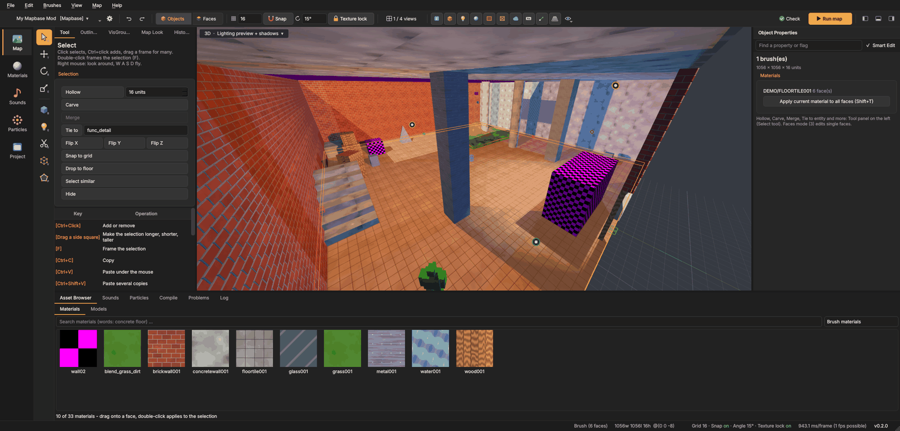
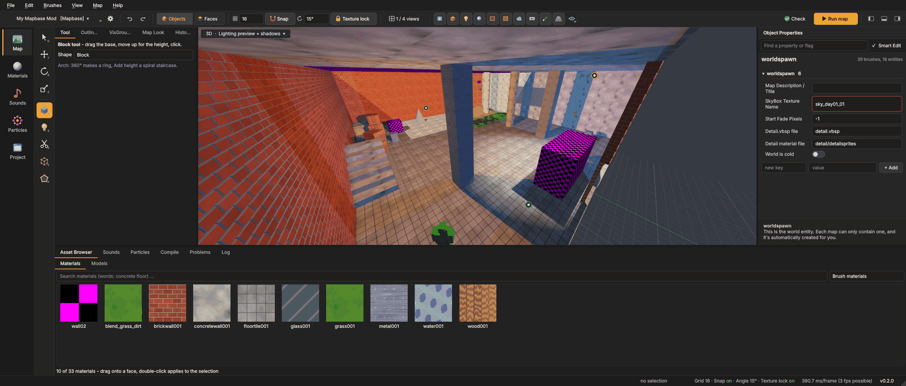
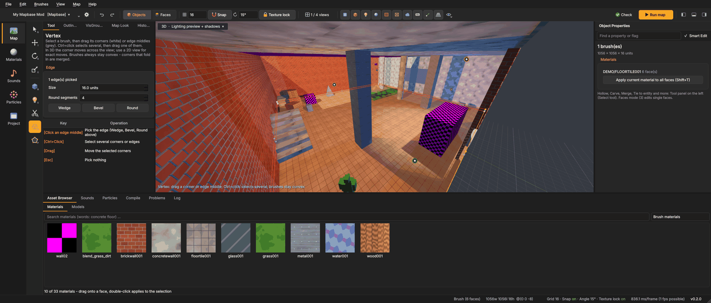

# Building
{: .no_toc }

Brushes are the solid shapes a Source map is made of: walls, floors, stairs, pillars. They are always **convex**:
no dents, no holes. A room is several brushes around an empty space. This page shows how to make and change them.

1. TOC
{:toc}

## Selecting

**Select tool (Q)**

- **Click** an object to select it. **Ctrl+click** adds or removes one.
- **Drag a frame** in empty space to select everything inside it.
- **Double-click** frames the selection (the same as **F**).
- **Ctrl+A** selects everything, **Ctrl+Shift+D** nothing.
- **Select similar** (Ctrl+Alt+O) selects every entity of the same class, every prop with the same model, or every
  brush with the same main material.
- **Go to ID ...** (Ctrl+Shift+G) selects the brush or entity with a number. Compile errors often name a brush by its
  id.
- **Select whole path** (Ctrl+Shift+P) selects every `path_track` or `path_corner` of a path.

**Resize right away.** Selected brushes show small squares on the middle of their sides. Drag one to make the brush
longer, shorter or taller. You do not need to switch to the Scale tool for this.

With something selected, the **Tool** tab lists actions for it: Hollow, Carve, Merge, Tie to, Move to world, Flip X,
Flip Y, Flip Z, Snap to grid, Drop to floor, Select similar and Hide. They are described below.

## Moving, rotating and scaling

All three tools work with a **gizmo** in the 3D view and by dragging in the 2D views.

**Move (T)**
- Drag an **arrow** to move along one axis, a **square** to move in a plane.
- **Shift+drag** moves a copy and leaves the original where it was.
- Small squares appear on the **corners** of the selection. Drag one onto a corner of another brush or model and the
  two line up exactly.
- **Arrow keys** nudge by one grid step, **Page Up / Page Down** up and down. In the 3D view, left/right and
  forward/back follow the direction the camera faces.

**Rotate (R)**
- Drag a **ring**. The angle snaps to the rotation step from the top bar (1° to 90°).
- Hold **Ctrl** for 1° steps.
- **Alt + arrow keys** rotate by one step without the mouse.
- Brushes, brush entities, props and NPCs can all be rotated.

**Scale (E)**
- Drag a **handle** on a side or corner of the box.
- Textures keep their size when texture lock is on, so they are not stretched.

**Snap.** Moving snaps to the grid, rotating to the rotation step. **Shift+W** turns snapping off and on. The grid goes
down to 0.125 units for fine detail.

**Snap to objects.** Moving with a corner square, dragging a side square and drawing a block also stop at the corners
and sides of other brushes and models - a green square shows where. This works off the grid too: a wall that ends at
x = 4.5 is met exactly, without changing the grid, so no gaps open at corners. Hold **Alt** while dragging to go past
them this once; **Shift+O** (also *Map > Snap to objects*, *Object snap* in the tool bar and the status bar and the check box in the tool
panel) turns it off until you turn it on again.

While you drag, the size in Object Properties and in the status bar changes with the mouse.

## The Block tool and shapes

**Block tool (Shift+B)**

1. Drag the base on the grid, or on any surface in the 3D view.
2. Move the mouse up or down to set the height.
3. Click or press **Enter** to create it. Keep dragging to start the next block right away.
4. **Esc** cancels.

The **Tool** tab shows the shape settings:

| Shape | What it makes |
|---|---|
| **Block** | a box |
| **Wedge (ramp)** | a slope |
| **Cylinder** | a round column with *Sides / pieces* sides |
| **Spike (pyramid / cone)** | a pyramid or a cone |
| **Sphere** | a ball made of pieces |
| **Arch / ring / spiral** | an arch: *Arc* (360° makes a ring), *Start angle*, *Wall width*; *Add height* makes a spiral staircase |
| **Stairs** | stairs with *Steps* steps |

Change the settings **right after** creating a shape and it is rebuilt with the new values. You do not need to draw
it again.

**Fit to surroundings** (on by default, for every shape but the plain block) fits the shape into what is already there:

- An arch drawn **against walls** (a rounded room corner, a curved wall along a wall) gets the space between its curve
  and those walls filled, so no void stays behind it.
- A shape standing **in a hole of a floor** (its box reaches below the floor's top and the floor lies around it) gets
  the floor filled around it, with the floor's texture.
- Brushes the shape **reaches into** (a floor it is sunk into, a wall it goes through) are cut around it.

The preview while you draw shows all of this. Switch it off to get the shape alone, exactly as drawn. Settings the box
cannot take (a wall wider than half the arch, more pieces, sides or steps than fit) are reduced to what fits instead of
failing; the Tool panel says what was limited. Drawing a shape snaps to the corners of other objects like a block does
(see *Snap to objects*).

The material of new blocks is the **current material**: the one you last picked in the Asset Browser.

## Clip

**Clip tool (Shift+X)** cuts the selected brushes along a plane.

- **2D view:** drag a line through the brushes.
- **3D view:** click three points on surfaces; they define the cutting plane.
- **Tab** switches which part stays: both parts, the back, or the front. The overlay at the bottom of the view says
  which.
- **Enter** cuts. **Esc** starts over.

## Vertex editing and edges

**Vertex tool (Shift+V)**: select a brush first, then:

- White squares are **corners**, grey squares are **edge middles**. Drag one to move it.
- **Ctrl+click** selects several, then drag one of them to move all.
- In the 3D view a corner moves across the view; use a 2D view for exact moves. In a 2D view, corners on top of each
  other are taken together.
- The brush always stays convex. Corners that fold in are merged.

### Edges: wedge, bevel, round

Click the **middle of an edge** to pick it. Its line turns yellow. Ctrl+click picks more edges. The **Edge** box in
the Tool tab then offers:

| Button | Result |
|---|---|
| **Wedge** | cuts from the far side of one face to the far side of the other: a block becomes a ramp |
| **Bevel** | one slanted face, *Size* units in from the edge |
| **Round** | a rounded edge with radius *Size* and *Round segments* faces (2 to 32) |

The same three are in the right-click menu while edges are picked. All picked edges change in one undo step.

Another way to round a corner: in Faces mode select the faces on **both sides** of it (click one, Ctrl+click the
others) and choose **Brushes > Round or bevel edge ...** (Ctrl+Shift+R). Set the *Radius* and the number of
*Segments* (*Auto* picks a number that suits the radius; 1 makes a bevel). The window stays open beside the map and
the views show the result while you change the values; **OK** applies it (one undo step), **Cancel** leaves the map
as it was.

- **Several brushes:** each side may be made of several brushes - a wall stacked from bands, even split at different
  heights on the two sides, or the outer corner of an L made of two walls. Select all their faces: the whole corner
  gets one curve, cut into every brush along it, so the pieces line up.
- **Several corners at once:** select the faces of more than one corner; all get the same radius and segments.
- **Faces off the corner** are left out (the window says how many) instead of stopping the whole rounding.
- **Inner corners** (a wall standing on a floor: select the floor's top and the wall's face) are filled up to the
  curve with a few strips - one brush per segment, none of them a sliver.
- **No holes:** where other brushes lie against both faces - a platform sunk into a floor that was cut out around
  it - the platform is rounded whole and the space it leaves next to the floor is filled with small brushes in the
  floor's texture.
- **Too big:** a radius that does not fit is made as big as fits, shown as *Limited to N units*. Fewer segments are
  used where more would leave pieces too thin. Bevel and Round in the Edge box behave the same.
- **Only as one brush:** if the pieces of a corner cannot be rounded apart (a skin thinner than half a unit on the
  face), the window offers **Merge and round**. It merges them into one brush first - only when you press it.
- **Always sound:** every brush a rounding makes is checked (closed, no tiny edges, nothing paper thin, no overlap);
  a result that would break is never applied.

## Polygon

**Polygon tool (Shift+P)** draws a brush from its outline:

1. Click the corners of the base, on the floor in the 3D view or in a 2D view.
2. **Enter** or a double-click makes the brush, as high as the last block.
3. **Backspace** removes the last corner, **Esc** cancels.

## Displacements

Displacements turn a brush face into a grid of points you can shape - hills, ditches, cliffs, paths blending into grass.
The **Displacement tool (Shift+D)** does everything:

1. **Make one.** Choose **Create** and click a face in the 3D view, or select brushes (or faces) first and press
   **Make**: every selected face, or the upward faces of the selected brushes, becomes a displacement. **Power** sets
   the detail: 2 (4 × 4 cells), 3 (8 × 8, the usual) or 4 (16 × 16). Only faces with four corners can be one.
2. **Shape it.** Pick a mode and drag over the displacement. The orange circle is the brush; the inner ring is where
   it works half as strong.
   - **Raise** lifts the ground, **Shift** + drag lowers it.
   - **Smooth** evens out bumps and sharp edges.
   - **Flatten** pulls everything towards the height where the stroke began (roads, building plots).
   - **Noise** adds random bumps for rough ground.
   - **Paint blend** paints the second texture of a blend material (shader WorldVertexTransition, e.g. grass to dirt);
     **Shift** + drag paints it away again.
3. **Size and strength.** **Ctrl + mouse wheel** or **[ ]** changes the radius, the **Strength** slider how much one
   pass does. A stroke - from pressing the mouse button to letting go - is one undo step.
4. **Neighbours.** Displacements next to each other can get a crack where their edges no longer meet. **Sew** moves
   the shared edge points to the same height (the selected displacements, or all of them when nothing is selected).
5. **Undo it.** **Flat again** turns the selected displacements back into plain faces.

Tips:

- Brushes with displacements are not solid in the game: only the displacement surface is. Put a nodraw brush or the
  skybox under big terrains, the map has to stay sealed.
- Neighbouring displacements need the same power on a shared edge to sew cleanly.
- The ground under the brush counts only if it faces about the same way as the face you started on, so walls next to
  a terrain stay untouched while you sculpt the ground.

## Hollow, Carve and Merge

These are in the **Tool** tab (Select tool), in the **Brushes** menu and in the right-click menu.

- **Hollow** (Ctrl+Shift+H) turns a block into walls around its inside: a room from a block. Set the wall thickness
  next to the button. A **negative** thickness puts the walls outside and keeps the inside as it is.
- **Carve** (Ctrl+Shift+C) cuts the selected brushes out of every brush they touch. Use it for doors and windows.
  Carve can produce many small brushes; for clean geometry, prefer building around openings with separate brushes.
- **Merge** (Ctrl+Shift+M) makes one convex brush around all selected brushes. If they did not fill that shape
  completely, the gaps are filled too, and the editor tells you so.

## Brush entities: Tie to and Move to world

- **Tie to** (Ctrl+T) turns the selected brushes into a brush entity. Pick the class next to the button:
  `func_detail` (does not cut visibility; use it for small details), `func_brush`, `func_door`, `trigger_once` and so
  on.
- **Move to world** (Ctrl+Shift+W) turns a brush entity back into world brushes.

See [Source mapping basics](mapping-basics.html#world-brushes-and-brush-entities) for when to use which.

## Copy, cut and paste

- **Ctrl+C** copies the selected brushes and entities, **Ctrl+X** cuts them.
- **Ctrl+V** pastes them under the mouse, resting on the surface there.
- **Ctrl+D** duplicates the selection in place.
- Copied objects are plain VMF text, so you can paste them into another map, even in another Mapsmith window.

**Paste special ...** (Ctrl+Shift+V) makes several copies at once:

| Field | Meaning |
|---|---|
| **Number of copies** | how many |
| **Offset per copy** | how far each copy is moved from the one before |
| **Rotation per copy** | how far each copy is turned from the one before |
| **First copy** | *Next to the copied objects* or *Under the mouse* |
| **Make entity names unique** | `door` becomes `door_2`, `door_3` ...; outputs between the copied entities follow |
| **Put before names** | an optional prefix for every name, e.g. `room2_` |

Example: a spiral of 12 pillars. Copy one pillar, *Number of copies* 11, *Offset per copy* 0 0 16,
*Rotation per copy* 0 30 0.

## Flip, snap, transform, drop

- **Flip** (Brushes > Flip): **left/right (X)** Ctrl+L, **front/back (Y)** Ctrl+Alt+L, **up/down (Z)** Ctrl+I. The
  selection is mirrored around its center; entity angles are mirrored too.
- **Snap to grid** (Ctrl+B) moves the selection so its corner lies on the grid.
- **Transform ...** (Ctrl+Alt+M): exact numbers for *Move by*, *Rotate by* and *Scale by*, around the selection's
  center, as one undo step.
- **Drop to floor** (Ctrl+Shift+F) lets the selected objects fall straight down onto what is below them.

## Make water

Build a block where the water should be (its top is the surface), select it and choose **Brushes > Make water**
(also in the right-click menu). The top face gets the current material if it is water, else the game's first water
material; all other faces get `tools/toolsnodraw`. If the map has no `water_lod_control`, one is added, and an
`env_cubemap` 64 units above the middle of the water (its *Brush faces* list names the water) unless a cubemap is
already near. All of it is one undo step.

## Hiding

- **H** hides the selection, **Ctrl+H** hides everything else, **U** shows everything again.
- To hide whole kinds of objects (all triggers, all tool brushes ...) use the
  [view switches](interface.html#view-switches).
- For named groups you can hide and show, use [VisGroups](entities.html#visgroups).

## Cordons

A cordon compiles only a part of the map. This is much faster while you work on one room.

1. Select what you want to compile.
2. **Map > Add cordon around selection** (Ctrl+Shift+K). A red box appears.
3. Compile as usual. Only what is inside the cordons is built; the cordon box seals it.
4. **Map > Cordons on (compile only inside)** switches them off and on. **Map > Remove all cordons** removes them.

Cordons are saved in the `.vmf`, but they are not part of the undo history.

## Tips

- Build on the grid. Brushes with corners off the grid make small gaps that cause leaks and lighting seams.
- Make walls from separate brushes that touch, not one hollowed giant block with carved holes. It compiles faster
  and is easier to change.
- Turn details (railings, pipes, trims, furniture) into `func_detail` or use props. See
  [Optimization](mapping-basics.html#visleafs-and-optimization).
- Use the [Problems](compiling.html#problems-and-leaks) check before compiling; it finds broken brushes.
