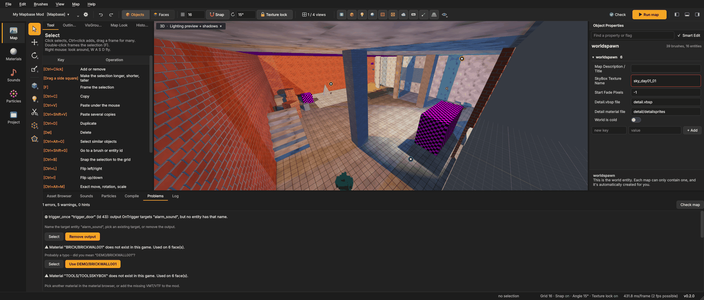

# Compiling and running
{: .no_toc }

A `.vmf` is only the source of a map. The game plays `.bsp` files, which the game's **compile tools** build:

| Tool | Step | What it does |
|---|---|---|
| **VBSP** | Geometry | turns the brushes into a BSP, cuts the world into visleafs, places the entities |
| **VVIS** | Visibility | works out which visleafs can see which others, so the engine draws only what may be visible |
| **VRAD** | Lighting | bakes light maps, shadows and bounced light from the light entities |

Mapsmith runs them for you, shows their progress and explains their messages.

1. TOC
{:toc}

## Run map (F9)

Press **F9** or the orange **Run map** button in the top bar. Mapsmith then:

1. runs the [problem check](#problems-and-leaks). If it finds errors, it asks whether to compile anyway;
2. saves the map (a new map asks for a file name first);
3. opens the **Compile and run** dialog, where you choose how to compile;
4. runs the steps and shows them in the **Compile** tab of the bottom panel;
5. copies the `.bsp` into the game's `maps` folder and starts the game with the map.

Press F9 again while a compile runs to cancel it.

{: .note }
The compile tools and the game executable come from the [game settings](getting-started.html#game-settings) (the **⚙** next to the
game). If a step says *no program set*, set its path there.

## The Compile and run dialog

The dialog has two modes, switched at the top: **Simple** and **Advanced**. Your choices are kept for each game.

**Preset** sets everything at once:

| Preset | Use it for |
|---|---|
| **Fast - a quick look** | testing layout and gameplay; VVIS `-fast`, VRAD with only 2 bounces |
| **Normal** | everyday compiles |
| **Final - best light** | the version you release; VRAD `-final` |
| **Custom** | appears when you change anything by hand |

### Simple

Cards for each step. A switch in a card's title turns the step on or off.

- **Geometry** (VBSP) always runs. **Detail brushes** and **Water** decide whether `func_detail` and water brushes are
  built; leave both on unless you are hunting a problem.
- **Visibility** (VVIS): **Quality** **Fast** or **Full**. Fast is good for testing; a released map should be compiled
  with Full.
- **Lighting** (VRAD): **Light level** **LDR**, **HDR** or **Both**, and **Quality** **Fast**, **Normal** or **Final**.
  *Both* takes about twice as long; pick one unless your mod lets players switch HDR.
- **Cubemaps**: starts the game after compiling, builds the reflections of every `env_cubemap` into the map and closes
  the game again. **Build for** LDR, HDR or both. It needs **Copy to the game's maps folder**. See [Cubemaps](#cubemaps).
- **After compiling**: **Copy to the game's maps folder**, **Run the game** and **Cheats** (`+sv_cheats 1`, on by
  default: `impulse 101` for all weapons and ammo, `noclip`, `god` while you test).
- **Game window**: how the game starts (also when it builds cubemaps): **Console** (`-console`), **Windowed**
  (`-windowed`), **Resolution** (a list, *Custom ...* or *The game's own setting*) and **Skip the intro video**
  (`-novid`).

### Advanced

The steps on the left: VBSP, VVIS, VRAD, Copy, Cubemaps, Game. Unticked steps keep their parameters and are skipped.

For the marked step you see two lists:

- **all parameters** the tool knows, each with *What it does*. Type in **Find a parameter ...** to search, and
  double-click (or **+**) to add one;
- the **Added** parameters. Double-click a value to change it, **Delete** removes one.

**Own parameter, e.g. -threads 8** with **+ Add** adds anything the list does not know, for tools with extra options.

**Command lines** at the bottom shows exactly what will run. **Copy** puts it on the clipboard, for a batch file or a
bug report.

## The Compile tab

While the tools run, the **Compile** tab in the bottom panel shows:

- a table of the steps with **State** (*waiting*, *▶ running*, *✔ done*, *✖ failed*, *– skipped*), **Time** and
  **Progress**;
- **Warnings and errors**: each message of the tools in plain words, with what it means and how to fix it. Known
  harmless messages (such as a missing optional `lights.rad`) are marked as harmless. Common errors are explained, among
  them *Texture axis perpendicular to face*, *Bad surface extents*, *MAX_POINTS_ON_WINDING*, an areaportal that
  *doesn't touch two areas*, *Too many light styles*, a displacement on a face without 4 corners and VVIS's missing
  portal file (*LoadPortals*: the map leaks);
- **Full output of the compile tools**: the complete text, for the cases the summary does not cover.

At the end a line says **Finished** or **Stopped**, with the time and the number of errors and warnings.
**Compile again (F9)** starts over with the same choices, **Cancel** stops a running compile.

If one step fails, the steps after it do not run. If the map **leaks**, VBSP still makes a BSP, but VVIS and VRAD are
skipped (they need a sealed map), and the map will be unlit and slow in the game.

## Problems and leaks

The **Problems** tab checks the map for mistakes that break the compile or the game. It runs before every compile;
press **Check** in the top bar (or **Check map** in the tab) to run it at any time.

Each problem has a colour for how bad it is (error, warning, hint), a line on how to fix it, a **Select** button that
selects the objects in the map, and often a button that fixes it right away. The checks:

| Problem | Fix button |
|---|---|
| A brush is not a valid convex solid (VBSP drops it or fails) | **Delete brush** |
| A brush with an edge shorter than a quarter unit, or thinner than half a unit somewhere (VBSP may drop it or leave a hole) | **Delete brush** |
| Two brushes exactly in the same place (their faces flicker and a click picks either one) | **Delete duplicate** |
| A material does not exist in the game | **Use …** when it looks like a typo |
| Faces with a texture scale of 0 (the compile fails) | **Reset scale** |
| An entity class is not in the loaded FGDs | **Rename to …** when it looks like a typo |
| A brush entity without brushes | **Delete entity** |
| A point entity with brushes | — |
| A prop with a model that does not exist | — |
| A `prop_static` whose model is not a static prop (VBSP deletes it), or a `prop_physics` without a collision model (the game removes it) | **Make prop_…** (the class the model is made for) |
| An `ambient_generic` whose *Is NOT Looped* flag does not match the sound: a looping WAV (cue point) with the flag on cannot be stopped, a one-shot WAV with it off plays only once | **Turn "Is NOT Looped" on/off** |
| More than one `sky_camera` (the 3D skybox may show the wrong one) | — |
| Shiny materials (`$envmap env_cubemap`) on brushes, but no `env_cubemap` in the map - in the game they mirror the sky (a shiny floor turns pink at sunset) | **Place env_cubemap** (at eye height above the player start, else in the middle of the map) |
| The compiled map in the game's `maps` folder has `env_cubemap`s whose reflections were never built (only when it is newer than the `.vmf`) | **Build cubemaps** opens the compile dialog with **Cubemaps** ticked |
| An output the entity's class does not have | **Use …** when it looks like a typo |
| An output to a target name no entity has | **Remove output** |
| An output to an input the target does not have | **Use …** when it looks like a typo |
| No `info_player_start` | **Add player start** |
| An `info_player_start` inside a brush (the player needs 32 × 32 × 72 units free above it, else he spawns stuck or falls through the floor) | **Move onto the floor** |
| A point entity outside the map, in the void (VBSP reports a leak from it) | — |
| Faces with a lightmap scale below 4 (very costly light) or above 128 (very blurry light); tool faces do not count | **Set to 16** / **Set to 64** |
| A prop whose origin is inside a brush - models are lit at their origin, so it turns black in the game | — (raise it, or give it a lighting origin with an `info_lighting`) |
| The map uses 85 % or more of an engine limit (brushes, brush sides, planes, entities, overlays, ...), or is over one - VBSP would stop with `MAX_MAP_...` | — (the line says what helps; **Map Budget** shows all limits) |
| World brushes that are only details - round shapes (9 or more sides) and small pieces (16 units or less) - make VVIS slow (hint) | **Make func_detail** (keep a brush world if it closes the map off from the void: detail brushes do not seal) |
| NPCs that walk, but no `info_node` in the map (they cannot find paths: they stand still or walk into walls) | **Place nodes around the NPCs** (a few on the free floor around each NPC - add more along the ways they should walk) |
| No light entities (hint) | — |
| The map leaks | — |

Every fix is one undo step.

**Damaged files.** A VMF with quotes typed inside a value (`"message" "say "hi""`) or a brush face without a valid
plane opens anyway: the inner quotes become `'`, the broken brush is left out, and the Log lists every repair. Saving
writes a clean file. Typed quotes in a value are always written as `'`, so this cannot happen again.

## Map budget

The **Map Budget** tab counts the map against the engine's limits while you work: brushes (8192), brush sides
(65536), planes (65536), map entities (8192; 16384 in Left 4 Dead 2, Portal 2, Alien Swarm and CS:GO), edicts (2048),
overlays (512), displacements (2048), cubemaps (1024), lights (8192) and static props. A `~` marks an estimate
(VBSP adds bevel sides and plane pairs; the game spawns more edicts than the map has). Counts turn orange above 80 %.
The limits are the `MAX_MAP_*` values of the engine's `bspfile.h`.

### Leaks

A **leak** is a hole from the inside of the map to the empty space around it. VBSP needs a sealed map: the inside of
the world must be closed off from the void by world brushes. An entity in the void, or a gap of any size between two
brushes, makes a leak.

When VBSP finds a leak, it writes a **pointfile** (`.lin`) next to the map: a line from an entity inside, through the
hole, to the outside. Mapsmith loads it at once:

1. The Problems tab opens and shows *The map is not sealed (leak)* with the entity nearest to the line. The 3D view
   draws the line in **red**.
2. **Show leak line** (in Problems) or **Show leak** (in the Compile tab) draws it in every view.
3. Follow the line from the entity to where it leaves the map. The hole is there.
4. Close it with a brush. On the outside of a map, use `tools/toolsnodraw` or a sky brush.
5. Compile again. The line is gone when the map is sealed.

**Map > Load pointfile (.lin) ...** loads a pointfile by hand, **Map > Clear leak line** hides the line.

Things that cause leaks:

- gaps between brushes, often from building off the grid;
- an entity (even a light or a sound) outside the walls;
- a brush entity used as an outer wall. `func_detail`, doors and other brush entities do **not** seal the map; only
  world brushes do.
- water or glass as the outer wall.

See [Source mapping basics](mapping-basics.html#leaks) for more.

## Cubemaps

Shiny materials reflect the nearest `env_cubemap`. Until the cubemaps are built, they reflect a default image, which
often looks too bright or wrong. The lighting preview already shows the reflections while you map (see
[Cubemap reflections](texturing.html#cubemap-reflections)); the game needs them built as described here.

Cubemaps are not built by the compile tools but by the game itself. Tick **Cubemaps** in the compile dialog: after
compiling, Mapsmith starts the game with `-buildcubemaps`, the game renders the view of every `env_cubemap` and saves
it into the `.bsp` in the `maps` folder, then closes.

- **Build for** decides whether LDR, HDR or both kinds of reflections are built. They must match the light level
  players use; with *Both* lighting, build both.
- Build cubemaps again after every compile; a new compile replaces the `.bsp` and its reflections.
- Cubemaps are built from the light of the compiled map, so build them after VRAD, as the dialog does.
- Forgot it? **Problems** says so (*reflections were never built*) as long as the map in `maps` has unbuilt
  cubemaps, and its **Build cubemaps** button opens the compile dialog with the step ticked. It also warns when shiny
  materials are used but the map has no `env_cubemap` at all.
- The game always ends with exit code 1 after building cubemaps. Mapsmith therefore looks into the map in `maps`
  instead: the log says how many cubemaps are now in it, and the step only fails when none were built.
- For reflections that line up with the room (Mapbase), give the cubemap a room box; see
  [Cubemaps and room boxes](entities.html#cubemaps-and-room-boxes).

You can also type `buildcubemaps` in the game's console while the map is loaded.

## Cordons

With cordons on, F9 compiles only what is inside them. Mapsmith writes a copy of the map named `<map>_cordon.vmf`, with
everything outside the cordons left out and the cordon box sealed, and compiles that. The game then runs
`<map>_cordon`. See [Cordons](building.html#cordons).

## Compiling all maps at once

The **Maps** tab of the Project page compiles several maps one after the other; see
[The Project page](project.html#maps).

## Tips

- Compile with the **Fast** preset while you build, and with **Final** before you release.
- Read the **Warnings and errors** list after each compile. A map that compiles can still have problems the warnings
  point at.
- A long VVIS time means too many visleafs: turn details into `func_detail`. See
  [Visleafs and optimization](mapping-basics.html#visleafs-and-optimization).
- A long VRAD time comes from big areas with a small **Lightmap scale**. Use 32 or more on large plain surfaces and on
  faces far from the player.
