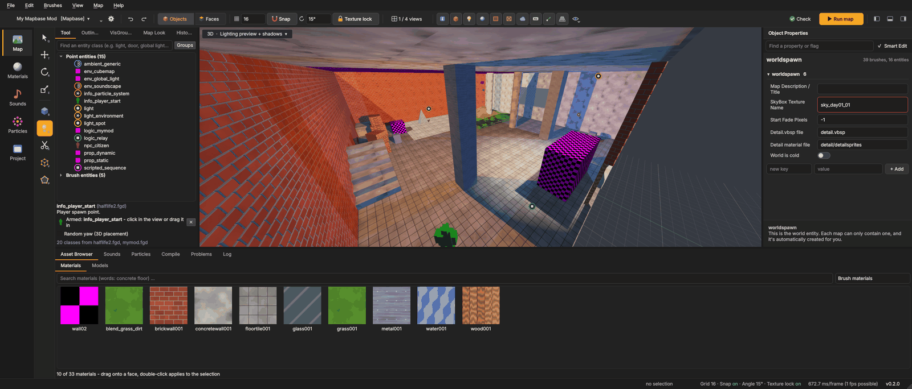
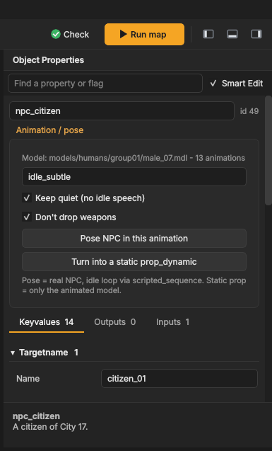
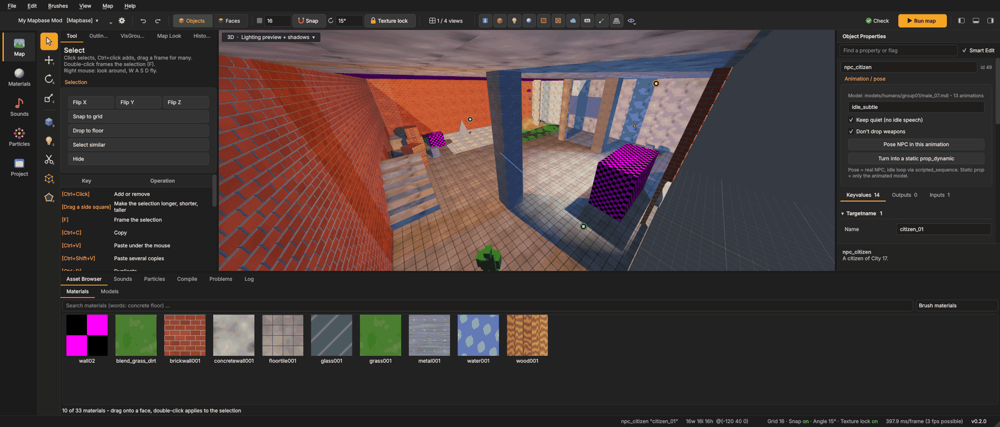
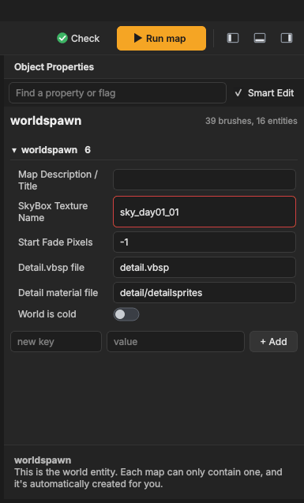
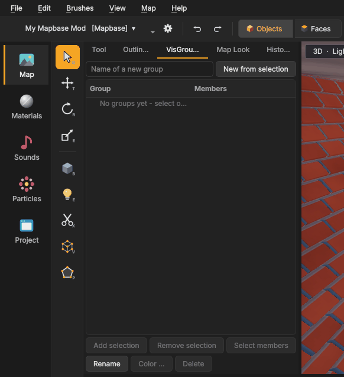

# Entities
{: .no_toc }

Entities are everything in a map that is not plain geometry: lights, the player start, props, NPCs, doors,
triggers, sounds, logic. **Point entities** sit at one place (a light, a prop). **Brush entities** are brushes with a
behaviour (a door, a trigger, `func_detail`). Which entities a game has, and which keys they take, comes from its
**FGD** files.

1. TOC
{:toc}

## Placing entities: the Entity tool

Press **Shift+E**. The **Tool** tab lists every entity class of the game, with its icon.

1. Type in **Find an entity class (e.g. light, door, global light) ...**. Words work too: `global light` finds
   `env_global_light`. **Groups** switches between A–Z and groups (AI, brush entities, effects, filters ...).
2. Click a class. It is now **armed**: the panel says *Armed: <class>*, and a preview of it follows the mouse in the
   view.
3. **Click** in the view to place it on the surface under the cursor. You can place several; it stays armed.
4. A **brush entity** (trigger, door ...) is built from the next box you **drag** with the Block tool's gestures.
5. Press the **✕** next to *Armed* to disarm; clicks in the view then select again.

- **Random yaw (3D placement)** turns every new prop to a random direction, so a row of barrels does not look copied.
- You can also **drag** a model from the Asset Browser's *Models* tab into the view. While you drag, the model itself
  follows the mouse as a see-through preview, standing on the surface under the cursor, with its name and size next to
  it; it lands exactly there as the prop class the model is made for: `prop_static` for static prop models,
  `prop_physics` with a collision model, otherwise `prop_dynamic`. The model's box is centred on the cursor, so even map pieces whose
  origin lies far away from what they show end up where you point. With *Random yaw* on, the preview already shows
  the turn the prop gets. Likewise you can drag a
  sound from the Sounds browser (an `ambient_generic`, or an `env_soundscape` for a soundscape) or a particle system
  (an `info_particle_system`).
- To turn existing brushes into a brush entity, select them and use **Tie to** (Ctrl+T); see
  [Building](building.html#brush-entities-tie-to-and-move-to-world).

### Changing the class

The class at the top of *Object Properties* is a search list: click it, type a few letters (several words narrow
it down, e.g. `prop phys`), move with the **arrow keys** and press **Enter**. With an empty search the classes
related to the current one come first (for `prop_static`: `prop_dynamic`, `prop_physics` …). The keys stay.
The mouse wheel scrolls the panel; it only changes a drop-down or number field you clicked into first, and it
never switches between *Keyvalues*, *Outputs* and *Inputs*. The sky list is the exception: rest the mouse on it for a
moment (without scrolling), then the wheel goes through the skies. Picking another object keeps the panel where you
had scrolled to.

Fields that name something of the game are drop-down lists you can scroll through or type into: the sky
(worldspawn *SkyBox Texture Name*, with pictures), soundscapes, sounds, models, particle systems, materials, decals and
sprites, entity names (targets) and animations.

## The properties panel

Select an entity and the right panel shows it.

- **The class** at the top. Pick another class and the entity changes class; its keys stay.
- The **id** next to it is the number compile errors use.
- Tabs: **Keyvalues**, **Outputs** and **Inputs**, each with how many there are.

### Keyvalues

Keys are grouped by where the FGD defines them: **Targetname** (the entity's name), **Angles**, the entity's own class,
**Flags**, **Placement** and so on. Click a group's title to fold it away.

Every key gets a fitting editor:

- lists of choices (with the value in brackets);
- yes/no keys and flags as **switches**;
- colours with a colour picker and the brightness;
- target names with a list of the map's entity names;
- models, sounds, particle systems and materials with a browser;
- animations with the model's sequence list.

The help area at the bottom of the panel explains the key you are in. With nothing in focus, it describes the class.

**Find a property or flag** filters keys and flags as you type.

**Smart Edit** off shows every key as plain text in a table. You can edit the raw key names and values
there, and **− Remove selected key** deletes one.

**+ Add**: the *new key | value | + Add* row at the bottom adds any key, even one the FGD does not know.

**Paste keys.** Lines like `"_light" "255 255 255 200"` or `skyname<Tab>sky_day01_01`, copied from a wiki or another
map, can be pasted into the panel (Ctrl+V); every key in them is set at once.

Several entities selected? The panel shows the keys they have in common; *(different)* marks keys whose values differ.
A change applies to all of them.

### Outputs and inputs

Source entities talk to each other with **outputs** and **inputs**: when something happens to one entity (an
*output*, like `OnTrigger`), it tells another entity to do something (an *input*, like `Open`).

The **Outputs** tab shows each output as a readable card: *When OnTrigger tell door_01 to Open*.

- **Connect to ...** (next to *+ Add output*) is the quick way - see [Connecting entities](#connecting-entities).
- **+ Add output** adds one.
- The *target* list offers the map's entity names; the *input* list offers that target's inputs.
- *Parameter* is passed to the input (e.g. a number for `SetSpeed`).
- *Delay* is in seconds; **once** removes the output after it fired the first time.

The **Inputs** tab lists every entity that sends something to this one, with **Go to** to select it.

**Connection lines:** with the *connection lines* [view switch](interface.html#view-switches) on, the views draw a
**green** line from the selected entity to every entity its outputs name, and a **blue** line from every entity that
fires at it. Names ending in `*` match every entity whose name starts that way, as in the game. **Click a line** to
jump to its output: the entity that sends it is selected and its card in the *Outputs* tab is outlined in green.

See [Source mapping basics](mapping-basics.html#outputs-and-inputs) for examples.

## Doors

A door in Source is an entity that moves: `func_door` slides a brush, `func_door_rotating` turns a brush around its
hinge, `prop_door_rotating` turns a door *model* (with a handle). Setting one up by hand means getting the move
direction angles, the sign of the turn, the hinge origin, spawnflags and sounds right. Mapsmith does that for you.

**Make a door:** build a block the size of the door (in the doorway), select it and choose **Make door** in the
Selection box of the Tool panel, in the right-click menu or in **Brushes > Make door**:

| Choice | What you get |
| --- | --- |
| **Swinging door** | `func_door_rotating` with its hinge on the left edge (no origin brush needed), opens 90° away from the player |
| **Sliding door** | `func_door` that slides up into the wall above |
| **Double door (swinging)** | the block is cut in the middle; two halves hinged on the outer edges, sharing one name, open together |
| **Double door (sliding)** | two halves that slide apart to the sides |
| **Door model (prop_door_rotating)** | a door model of the game stands where the block was, hinge at the block's left edge, with a lever handle |

The new door works right away: the player opens it with **Use**, it closes again after 4 seconds (door models stay
open, like HL2's), and it gets the game's door sounds (script sounds with "door" in the name: moving, stop, locked).
A `func_door` or `func_door_rotating` you place with the Entity tool or make with **Tie to** gets the same settings.

**See how it opens:** while a door is selected, the views draw its motion:

- swinging doors and door models: the **hinge** (a yellow line), an **arc with an arrow** for the way the free edge
  travels and a **ghost** of the open door. A door that opens away from the player shows both ways (the second one
  fainter).
- sliding doors: an **arrow** to the open position and a ghost there.

**The Door box** (Object Properties, above the tabs) changes all of it in plain words; each change is one undo step:

- **Opens**: *Swings - hinge on the left/right* or *Slides up/down/left/right*. Left and right are seen from the door's
  front (the arc shows which side that is). Switching between swing and slide changes the class.
- **Turns**: *Away from the player*, *Always to the front* or *Always to the back*; **Angle** how far it turns.
- **Speed** (units or degrees per second), **Closing**: *Stays open* or *closes after* some seconds.
- Switches: **Opens when the player presses Use**, **Opens when the player walks into it**, **Starts locked**
  (an `Unlock` input opens it up; the *Locked* sound plays when someone tries it).
- Door models: **Model** (the game's door models) and **Handle** (none, lever, push bar, keypad). The views draw the
  door with the chosen handle, so you see where it sits. Dragging a door model into the view makes a
  `prop_door_rotating` right away, and *Problems* points out a door model placed as `prop_physics` (it would fall over).
- **Sounds**: one list per sound (*Opening*, *Closing*, *Stops*, *Locked*; door models: *Opening*, *Moving*,
  *Closed*, *Locked* - empty keeps the model's own), door sounds listed, each with **▶** to listen.
- **Test open** plays the opening in the views at the door's real speed.

**Areaportals:** a door between two rooms should close an *areaportal*, so the game skips drawing what is behind it.
Put a `func_areaportal` brush (tools/toolsareaportal) into the doorway; the Door box then offers **Link areaportal**
(it names the door if needed and sets the portal's *target*). The [Problems](compiling.html#problems-and-leaks) list warns about a door
standing in an areaportal that is not linked to it and links it with one click.

## Connecting entities

To make one entity trigger another (a button opens a door, a trigger plays a sound):

1. Select the entity that sends (the button, the trigger).
2. Click **Connect to ...** - in the Selection box of the Tool panel, in the right-click menu or in the *Outputs* tab.
3. Click the entity that should react in a view (a green line follows the mouse; **Esc** cancels).
4. A small window lists the likely pairs, the best one chosen: *OnPressed → Open* for a button and a door,
   *OnTrigger → PlaySound* for a trigger and an `ambient_generic`, *OnTrigger → Toggle* for a light. Pick another pair
   or any output and input from the lists, set a delay, parameter or *Only once*, and press **Enter**.

The output is added in one undo step. If the target has no name yet it gets one (`door_1`, `sound_1`, `button_1`
...), because outputs find their target by name. The new output is shown in the *Outputs* tab.

## The Models page

The **Models** button in the side bar shows every model of the game and its mods.

- **Folders** on the left (`props_c17`, `props_junk` ...) with the number of models in each; **All models** shows
  everything. The search box finds models by words in their path, in any order (`bench wood`).
- **Pick a model** to see it in 3D on the right: left drag turns it, right drag moves it, the wheel zooms, a
  double-click frames it again. **Wireframe** shows its triangles. The grid under it has squares of 16 units (64 for
  big models), so you can judge its size.
- **Skin** and the **body group** boxes (a lid, a helmet, a sign ...) change the model as it will look in the map.
- Below: its size in units, triangles, animations, surface, whether it was made as a **static prop** and its
  **physics** (collision model, mass, breakable settings). **Materials** lists what it is painted with; click one to
  open it in the Material Editor. Missing ones are shown in red - the game draws them as a checkerboard.
- **Place in map** (or a double-click in the list) switches to the map with the entity tool ready: every click places
  the model. **Place as** picks the entity: `prop_door_rotating` for door models, `prop_static` for models made as
  static props, `prop_physics` for models with a collision model, `prop_dynamic` otherwise - change it if you need
  something else. The skin goes with it (and
  the body groups, except for `prop_static`, which has none in the map file).
- You can also **drag** a model onto the **Map** button of the side bar; the map opens and you drop the model into a
  view. **Copy path** puts `models/.../name.mdl` on the clipboard.

### Importing your own models

**Import ...** on the Models page (or *File › Import into the mod › Model ...*) brings a model made in Blender or
another program into the mod: an `.obj` (with its `.mtl` and pictures) or a reference `.smd`.

- **Kind**: *static prop* (part of the world), *physics prop* (falls, can be picked up) or *dynamic prop*.
- **Units** and **Y is up**: most programs save metres with Y up (Source: inches, Z up). The line at the top shows
  the size it will have in the map - a door is about 56 × 108 units, a player 72 high - so wrong units show before
  importing. The model stands on the ground at its middle.
- **Collision**: *Wrapped* (one solid shape around it, best for most props), *Box*, or *Its separate parts* (each
  separate piece of the model on its own, e.g. a table top and legs). **Mass** for physics props: from its size, or
  your own value.
- **Materials**: each material of the model becomes a model material from its picture (named in the `.mtl`, or a
  picture with the material's name next to the model); without a picture it gets the `.mtl`'s colour.
- Mapsmith writes the sources (`modelsrc/<folder>/<name>/`: reference and collision `.smd`, `.qc`) and compiles them
  with the game's **studiomdl** (in the SDK's `bin` folder, next to VBSP; choose it with *studiomdl ...* if it is
  elsewhere). The model appears in `models/<folder>/<name>.mdl`. If studiomdl fails, its reason and full output are
  shown and nothing stays behind.

*File › Import into the mod › Imported files ...* lists everything imported into the mod; **Remove import** takes
one out again, also after a restart.

## NPCs and animated models

Select an NPC or a `prop_dynamic`. The **Animation / pose** box (**Animation** for props) lists the model's
animations.

- **Pose NPC in this animation**: places a `scripted_sequence` that keeps the NPC in that animation (a real NPC, with
  its idle loop). **Keep quiet (no idle speech)** and **Don't drop weapons** set the matching flags.
- **Turn into a static prop_dynamic**: replaces the NPC with its model, standing in the animation. Good for scenery
  people who should never move.
- For a `prop_dynamic`: **Play this animation (DefaultAnim)**.

The 3D view shows props and NPCs with their real model and textures.

## Lights and the lighting preview

The 3D view's **Lighting preview** (F6) lights the map from its light entities: `light`, `light_spot` and
`light_environment`. It uses the same falloff formulas as VRAD, so the brightness is close to what the compile bakes.

- **Real-time shadows** (F7): the sun and the nearest spot and point lights cast shadows.
- `_light` sets colour and brightness; `_constant_attn`, `_linear_attn`, `_quadratic_attn` and the 50% / 0% distances
  change the falloff, exactly as in the game.
- Bounced light (radiosity) is not previewed; the compiled map is brighter in corners.

See [Lighting](mapping-basics.html#lighting) for how Source lighting works.

## The sky and its light

With nothing selected, the panel shows the map's own settings (worldspawn). **Map > Map properties ...** does the same.

- **SkyBox Texture Name** is a list of every sky of the game, each with a small picture. Faces with
  `tools/toolsskybox` show the chosen sky in the 3D view.
- A sky from Valve's games **brings its light**. Its sun direction, sun colour and ambient colour (as used in Valve's
  own maps) go into `light_environment`, `env_sun`, `shadow_control` and `env_global_light`, in one undo step. If the
  map has no `light_environment`, one is added above the player start. Change the values afterwards as you like.
- A red frame around the sky name means the game has no sky by that name.

## Cubemaps and room boxes

An `env_cubemap` captures the surroundings for reflections. Place one in every room with shiny surfaces, at head
height, away from walls.

With **Mapbase**, reflections can be **parallax-corrected**: they line up with the room instead of floating. Select an
`env_cubemap`:

1. Press **Add room box (fit to the walls)**. A box is fitted to the walls around the cubemap.
2. Drag the squares on its sides in the view to change it, or type the sizes.
3. **Fit to the walls** fits it again, **Select box** selects the box entity, **Remove** removes it.

The editor creates and names the `parallax_obb` and links it to the cubemap. Cubemaps are built after compiling; see
[Compiling](compiling.html#cubemaps).

## Decals and overlays

Both put a texture onto brush faces: a sign, a crack, a stain, an arrow.

- **`infodecal`** is put on by the game while the map loads. Its size is the texture's size (times the material's
  `$decalscale`); it lands on the nearest face that faces it.
- **`info_overlay`** is put on by the compiler. It can be any size, and it is cut to the faces listed in its *Brush
  faces* (`sides`) key.

To place one:

1. Pick the material in the Asset Browser (decal materials are usually under `decals/` or `overlays/`).
2. Arm `infodecal` or `info_overlay` with the Entity tool and click a face in the 3D view.

The decal takes the material as its *Texture*. The overlay gets the clicked face as its only side, lies flat on it,
starts as big as the texture and is upright seen from the front (on floors the texture's top points along +Y).

The views draw both on the brushes as the game shows them, see-through parts included; the small box at the entity
stays for moving it. Clicking the drawn decal or overlay selects it. **Show > Other entities** hides them with the
other helpers. Decals that the game would bend around a corner are only drawn on the face they sit on.

## Soundscapes

An `env_soundscape` plays a soundscape (ambient sound) while the player is in its area.

With a soundscape entity selected, its **area** can be a **sphere** or a **block**:

- **Sphere**: the entity's *radius*. The views draw the sphere while the entity is selected; drag its squares to
  change the radius. A radius of -1 means the whole map.
- **Block**: a `trigger_soundscape` brush around the entity, which you can resize like any brush. The editor sets up
  the link: the trigger's *soundscape* key names the entity, and the entity becomes `env_soundscape_triggerable`.

The soundscape itself (what it plays) is edited on the **Sounds** page; see
[Soundscapes](sounds-particles.html#soundscapes).

## Instances (func_instance)

A `func_instance` places the content of another `.vmf` in your map, moved and turned with the entity. Mapbase, Portal 2
and Counter-Strike: Global Offensive's compile tools support them.

- The instance's brushes and entities are **drawn in place**, read-only, with cyan edges. Clicking them selects the
  `func_instance`.
- The **Instance** box in the properties shows the file (**Browse ...**; it is looked for next to the map and in the
  game's map folders), the `$variables` it fills in (*replace01*, *replace02* ...) and the parameters the instance
  offers.
- **Read file again** after you changed the instance's `.vmf`.
- **Collapse instance** puts its content into the map for real, with names fixed up the way VBSP does it
  (`instance-name` prefix or postfix; `@name` and `!name` stay global). One undo step.

Instances inside instances are not drawn.

## VisGroups

VisGroups are named groups of objects you can show and hide together, like "Detail", "Lights" or "Room 2".

1. Select objects, type a name in **Name of a new group**, and press **New from selection**.
2. The tick next to a group shows or hides its members.
3. **Add selection** and **Remove selection** change the group marked in the list.
4. **Select members** (or a double-click) selects everything in it.
5. **Rename** (or F2), **Color ...** and **Delete** (the members stay in the map).

Groups can be nested: a new group is created inside the marked group. Every change is one undo step. Hidden groups are
saved as hidden in the `.vmf` and come back hidden when you open the map.

## Tips

- Give entities names only when something needs to find them (outputs, parenting). Unnamed lights compile into static
  light; a named light becomes switchable and costs more.
- Use the Outliner (left panel) to find entities by name or class, or [Find entities](safety-search.html#find-entities)
  for searches by key.
- The [Problems](compiling.html#problems-and-leaks) check finds outputs to entities that do not exist and inputs a
  target does not have.
