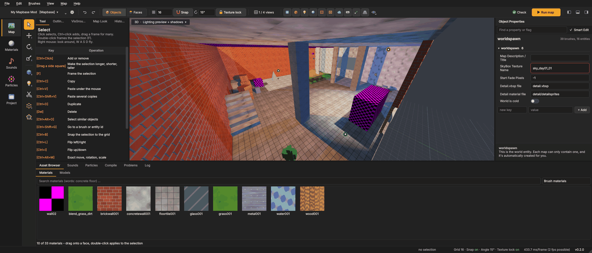
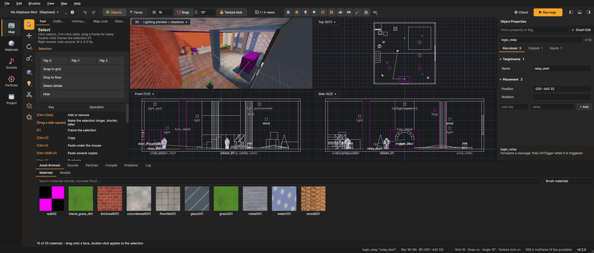
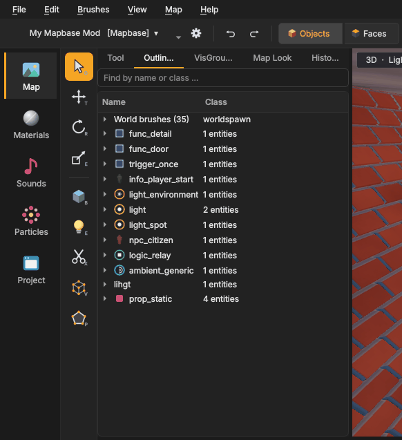

# The interface
{: .no_toc }

1. TOC
{:toc}

The window has six parts, from left to right and top to bottom:

1. **Side bar**: the pages *Map*, *Materials*, *Models*, *Animations*, *Sounds*, *Particles* and *Project*.
2. **Tool strip**: the tools for building the map.
3. **Top bar**: the game, undo and redo, selection modes, grid and snapping, view switches, *Check* and *Run map*.
4. **Left panel**: the *Tool*, *Outliner*, *VisGroups*, *Map Look* and *History* tabs.
5. **The views**: one 3D view, or 3D plus top, front and side.
6. **Right panel** with *Object Properties*, the **bottom panel** with browsers and logs, and the **status bar**.

## The start page

When Mapsmith opens it shows the start page (also **File > Start page**):

- **Continue** opens the map you worked on last, in its mod, with a picture of it (taken when you saved).
- **Recent** lists the other maps you worked on lately; double-click one to open it in its mod.
- **Start new project** makes a new mod built on Half-Life 2 with Mapbase, installs Mapsmith's features into it and
  opens a first map: a closed room with a light, a player start and a cubemap, saved in the mod's map folder - ready
  to build on and to run. (**File > New project** does the same.)
- **Open a map ...** and **Go to the editor**.

Untick **Show at startup** to start straight in the editor.

## The side bar

Each button fills the window with one page:

| Page | What it is for |
|---|---|
| **Map** | Building the map: the views, tools and panels. |
| **Materials** | Every material of the game on the left; click one to edit it. See [Texturing and materials](texturing.html#the-material-editor). |
| **Models** | Every model in 3D, with skins and body groups. See [Models](entities.html#the-models-page). |
| **Sounds** | Sounds, sound scripts and soundscapes. See [Sounds](sounds-particles.html). |
| **Particles** | The particle viewer. See [Particles](sounds-particles.html#particles). |
| **Project** | Your mod: *Overview*, *Maps*, *Menu*, *Source control* and *Ship*. See [The Project page](project.html). |

While another page is shown, the map's panels and keys step aside, so Delete or H cannot change the map without you
seeing it. Click **Map** to come back.

*Sounds* and *Particles* are also tabs of the bottom panel while you map, so you can drag a sound or a particle system
straight into the map. The browser moves to its page when you open the page, and back to the bottom panel afterwards.

## The tool strip

The narrow column of icons next to the side bar holds the tools. The small letter in each icon's corner is its key.

| Icon | Tool | Key | What it does |
|---|---|---|---|
| Arrow | **Select** | Q | Click to select, drag a frame for many; squares on the sides resize brushes. |
| Arrows | **Move** | T | Move with the gizmo; Shift+drag moves a copy. |
| Circle | **Rotate** | R | Rotate with the gizmo rings. |
| Box arrow | **Scale** | E | Resize with the handles on the box. |
| Cube | **Block** | Shift+B | Draw blocks and other shapes. |
| Light bulb | **Entity** | Shift+E | Place entities. |
| Scissors | **Clip** | Shift+X | Cut brushes. |
| Wire cube | **Vertex** | Shift+V | Move corners, pick edges. |
| Pentagon | **Polygon** | Shift+P | Draw a brush from its outline. |
| Hill | **Displacement** | Shift+D | Make terrain from faces, sculpt it and paint blends. |

The [Building](building.html) page describes each tool.

## The top bar

From left to right:

- **Mod**: the mod (or game) you work on - click it to switch. Your own mods (Steam's `sourcemods`, a new one
  included) are listed first, the Steam games below; the search field finds any of them. **⚙** opens its
  [game settings](getting-started.html#game-settings).
- **Undo** and **Redo** (Ctrl+Z, Ctrl+Y).
- **Objects | Faces**: the selection mode. *Objects* (5 or 4) selects whole brushes and entities. *Faces* (3)
  selects single faces for texturing.
- **Grid** (the grid icon and the number): the grid size, from 0.125 to 1024 units. **[** and **]** make it smaller or
  bigger.
- **Snap** (the magnet, Shift+W): snapping to the grid and to the rotation step, on or off.
- **Rotation step** (the circular arrow and the angle): what the rotate tool and Alt+arrows turn by, from 1° to 90°.
  **Ctrl+[** and **Ctrl+]** change it.
- **Texture lock** (the padlock): textures stay glued to faces while you move and rotate.
- **1 / 4 views** (Shift+Alt+Z): one 3D view, or 3D plus top, front and side.
- **View switches**: a row of small icons, described in the next section.
- **Check**: runs the problem check (see [Problems](compiling.html#problems-and-leaks)).
- **Run map** (orange, F9): compile and start the game.
- The three **panel buttons** at the far right show or hide the left, bottom and right panels.

Every panel can be made as small as you like by dragging its edge. The small orange **corner handles** at the lower
left and lower right corners of the views move two edges at once: drag one to make the views bigger (or smaller) in
both directions, together with the bottom panels and the side panel next to it.

### View switches

**Hide tools** (Ctrl+Alt+T) hides triggers, clips and every other tool brush with one click, so you can build
without them in the way. Click it again to bring them back. They stay in the map and in the compile.

These icons decide what the views show. They only change the views, not the map or the compile.

| Switch | Shows or hides |
|---|---|
| Helper entities | logic, info, paths, sound entities and other entities without a model |
| Models | props |
| Lights | light entities |
| Cubemaps | env_cubemap and their room boxes |
| Triggers | trigger brushes |
| Tool brushes | clip, nodraw, hint, skip and other tool brushes and faces |
| Sky | sky brushes |
| **Aa** Entity names | the name (or class) under each entity in the 2D views, when zoomed in far enough |
| Connection lines | lines from the selected entities: **green** to what their outputs fire at, **blue** from what fires at them |
| 3D grid | the grid in the 3D view |

The **Show** button at the end opens the full list with every kind of object: world brushes, brush entities,
triggers, tool brushes and faces, sky brushes, models, NPCs, lights, cubemaps and other entities. At the top of the
list, **Hide triggers and tool brushes** and **Only geometry** hide several kinds at once; **Show everything** brings
everything back. The same list is in **View > Show** and in each view's corner menu. While anything is hidden, the
top right corner of each view says what (*Hidden: triggers, tool brushes*).

### Frame rate limit

The views only draw when something changes. While you fly, drag or move things they draw at most as often as
**View > Frame rate limit** allows: 30, 60, 120, **144** (the default), 200 or 240 frames per second, or *No limit*.
A lower limit keeps the graphics card cooler and quieter.

## The left panel

The left panel has five tabs:

- **Tool**: what the current tool can do, its options and a *Key | Operation* table with every key of the tool (your
  own shortcuts included). With the Select tool and something selected, it also lists the actions for the selection:
  *Hollow, Carve, Merge, Tie to, Move to world, Flip X / Y / Z, Snap to grid, Drop to floor, Select similar* and
  *Hide*. With the Entity tool it is the list of entity classes, and with the Block tool the shape settings.
- **Outliner**: every object of the map, grouped by class. Type in *Find by name or class ...* to filter. Click an
  entry to select it.
- **VisGroups**: groups of objects you can show and hide together. See [VisGroups](entities.html#visgroups).
- **Map Look**: the look of the map with the mapbase-fidelity add-on (clouds, light shafts, colour grading, water).
  See [mapbase-fidelity](mapbase-fidelity.html).
- **History**: every change you made. Click a line to go back or forward to it. See
  [History](safety-search.html#history).

## Object Properties (the right panel)

The right panel shows what is selected:

- **Nothing selected**: the map's own settings (worldspawn): sky, detail sprites, and so on. **Map > Map properties ...**
  shows the same.
- **An entity**: its class, then the tabs **Keyvalues**, **Outputs** and **Inputs**. See
  [Entities](entities.html#the-properties-panel).
- **Brushes**: how many, their size, and which materials they use, with *Apply current material to all faces*.
- **Faces** (face mode): the material, scale, shift, rotation, lightmap scale and justify buttons. See
  [Texturing](texturing.html).

*Find a property or flag* at the top filters the keys. **Smart Edit** switches between friendly editors and the plain
key/value list. At the bottom of the panel, a help area explains the key you are working in.

## The bottom panel

| Tab | What it is |
|---|---|
| **Asset Browser** | Materials and models: search, filters and pictures. Drag a material onto a face or a model into the view. The selected tile gets an orange frame (the picture keeps its colours). The panel never gets lower than one row of tiles with their names - in a low panel the pictures get smaller. **Recent ▾** next to the search lists the materials used lately (click: current, double-click: apply, or drag onto a face). |
| **Sounds** | The sound browser (also its own page). |
| **Particles** | The particle browser (also its own page). |
| **Compile** | The steps, warnings and errors of the last compile. |
| **Problems** | The problem check with Select and fix buttons. |
| **Map Budget** | Brushes, sides, planes, entities, edicts and more against the engine limits (see Compiling). |
| **Log** | Messages of the editor. |

Everything shown as text can be copied: select lines in the log or the compile output and press **Ctrl+C**, or
right-click > **Copy all**. The compile's warnings and errors copy with **Ctrl+C** or right-click **Copy**; **Copy all**
in the *Compile* and *Problems* tabs copies everything at once - handy for a search or a bug report.

## The views

Each view has a small menu in its top left corner, for example *3D · Lighting preview + shadows ▾*. It switches:

- the camera: **3D**, **Top (X/Y)**, **Front (Y/Z)**, **Side (X/Z)**;
- the look of the 3D view: **Lighting preview** (F6), **Textured (unlit)** (F5) or **Wireframe** (F8);
- **Real-time shadows** (F7) in the lighting preview;
- **Cubemap reflections** in the lighting preview (see [Cubemap reflections](texturing.html#cubemap-reflections));
- **mapbase-fidelity look**: clouds and colour grading as the add-on shows them;
- the **Show** list.

### Moving the camera

| Input | 3D view | 2D views |
|---|---|---|
| Right mouse (hold) | look around; W A S D move, Q / E down / up, Shift faster | — |
| Mouse wheel | move forward and back; while looking around, changes the fly speed | zoom |
| **Z** | fly mode on/off: look around without holding the mouse button | — |
| Alt + left mouse | orbit around the selection | — |
| Middle mouse | pan | pan |
| **F** | frame the selection (or the whole map) | frame |
| F2 / F3 / F4 / Ctrl+F1 | top / front / side / 3D camera in the active view | |

A quick right click without moving opens the menu for the object under the cursor. Holding the right button to look
around never opens it.

### Show in … and Find in map

Wherever an asset appears, its right-click menu leads to it:

| Right-click on | Entries |
|---|---|
| a face or brush in a view | **Show in Asset Browser**, **Edit in Materials page**, **Find in map**, **Copy name** for each of its materials |
| a prop or other entity in a view | **Show in Asset Browser** and **Show in Models page** for its model; **Show in Sounds page** for its sounds; **Show in Particles page** for its particle system; **Edit soundscape in Sounds page** for a soundscape |
| a material, model, sound or particle field in Object Properties, the brush's material list | the same entries |
| a material or model in the Asset Browser, the Materials page or the Models page | the other places, **Find in map**, **Copy name** |

With several objects selected, each asset gets its own submenu. **Find in map** selects everything that uses the
asset: every face with the material (in face mode), or every entity with the model, sound or particle system.

## The status bar

At the bottom, from left to right:

- what is selected (*Brush (6 faces)*, *npc_citizen "citizen_01"*, *3 brushes, 2 entities*);
- its size (width, length, height) and center;
- where the mouse points in the 3D view and how far away that is;
- grid, snap, angle and texture lock, with **on** in green and **off** in grey;
- how long a frame takes and the frame rate limit. Hover over it for triangles, draw calls, lights and how many
  frames were really drawn;
- the version. When an update is out, it turns into an **Update to …** button.
