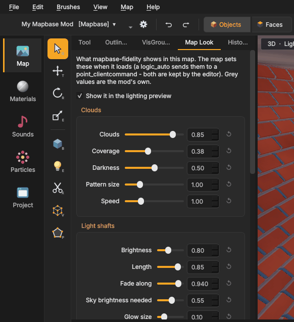

# mapbase-fidelity
{: .no_toc }

**mapbase-fidelity** is a graphics and sound add-on for Mapbase mods: drifting clouds, light shafts from the sun,
colour grading, ambient occlusion, walls with real depth, better water and more. Mapsmith knows it and lets you set
its look per map and preview it while you build.

Everything on this page is optional. A map made with these settings still works in a mod without the add-on; the
settings then simply do nothing.

1. TOC
{:toc}

## Does my mod have it?

Mapsmith treats a mod as having mapbase-fidelity when it finds the add-on's `cfg/fidelity.cfg`, its shaders, or its
shader library in the mod's `bin` folder. Mapsmith brings the add-on ready-built: **Project › Features › Install
features** puts it into the mod with one click (see [the Project page](project.html#install)) - nothing to build.

Without it, the Map Look tab says so: your values are then only shown in the editor's preview, and players see them
once the mod has the add-on.

## Map Look

The **Map Look** tab in the left panel sets what the add-on shows **in this map**.

- Every value has a slider and a number. Hover over the name for a description and the console variable behind it.
- **Grey** values are the mod's own (from `cfg/fidelity.cfg`): the map does not change them.
- Change a value and it becomes the map's own. **↺** (*Back to the mod's own value*) undoes that.
- **Show it in the lighting preview** turns the preview of the look on and off in the 3D view. The view menu's
  *mapbase-fidelity look* does the same.

Every change is one undo step (*Map look*).

### The values

| Group | Value | Console variable | Range | Meaning |
|---|---|---|---|---|
| Clouds | **Clouds** | `r_fidelity_sky_clouds` | 0 – 1 | how visible the drifting clouds in the skybox are; 0 = none |
| Clouds | **Coverage** | `r_fidelity_sky_clouds_coverage` | 0 – 1 | how much sky they cover: 0.3 is a lot, 0.7 a few wisps |
| Clouds | **Darkness** | `r_fidelity_sky_clouds_darkness` | 0 – 1 | how dark their thick parts are |
| Clouds | **Pattern size** | `r_fidelity_sky_clouds_scale` | 0.1 – 4 | bigger means smaller clouds |
| Clouds | **Speed** | `r_fidelity_sky_clouds_speed` | 0 – 4 | how fast they drift, times the wind |
| Light shafts | **Brightness** | `r_fidelity_godrays_intensity` | 0 – 2 | brightness of the shafts from the sun |
| Light shafts | **Length** | `r_fidelity_godrays_length` | 0 – 1 | how far they reach towards the sun |
| Light shafts | **Fade along** | `r_fidelity_godrays_decay` | 0.5 – 1 | how quickly a shaft fades along its length |
| Light shafts | **Sky brightness needed** | `r_fidelity_godrays_threshold` | 0 – 1 | from which sky brightness the sky casts shafts |
| Light shafts | **Glow size** | `r_fidelity_godrays_radius` | 0 – 0.5 | size of the glow around the sun, in screen heights |
| Light shafts | **Lens flare** | `r_fidelity_lensflare` | 0 – 1 | a faint lens flare from the sun |
| Image | **Exposure** | `r_fidelity_exposure` | 0.25 – 3 | brightness of the whole picture |
| Image | **Contrast** | `r_fidelity_contrast` | 0 – 1 | a soft S-curve |
| Image | **Saturation** | `r_fidelity_saturation` | 0 – 2 | 1 is unchanged, 0 is grey |
| Image | **Vibrance** | `r_fidelity_vibrance` | 0 – 1 | extra saturation for dull colours only |
| Image | **Temperature** | `r_fidelity_temperature` | −1 – 1 | cold and blue to warm and orange |
| Image | **Tint** | `r_fidelity_tint` | −1 – 1 | magenta to green |
| Image | **Lift shadows** | `r_fidelity_lift` | 0 – 0.2 | lifts the darkest parts |
| Image | **Mid-tones** | `r_fidelity_gamma` | 0.5 – 2 | above 1 brightens the mid-tones |
| Image | **Highlights** | `r_fidelity_gain` | 0.5 – 2 | gain of the bright parts |
| Image | **Clarity** | `r_fidelity_clarity` | 0 – 1 | local contrast; brings out relief and texture detail |
| Image | **Vignette** | `r_fidelity_vignette` | 0 – 1 | darker corners |
| Water | **Sun glint** | `r_fidelity_water_glint` | 0 – 6 | how brightly the sun glints on `Water_Fidelity` water |
| Water | **Shore foam** | `r_fidelity_water_foam` | 0 – 2 | foam where the water is shallow at the shore |

### How a map sets them

The game reads these values as console variables. When you change one, Mapsmith keeps two entities in the map:

- a `logic_auto` named `fidelity_look`, which fires when the map loads, and
- a `point_clientcommand` named `fidelity_look_command`, which receives the commands, such as
  `r_fidelity_exposure 1.1`.

The add-on allows maps to set exactly these variables. Players' own settings (on/off switches and quality) are not
touched. Do not edit the two entities by hand; the Map Look tab rewrites them. When every value is back to the mod's
own, both entities are removed.

The values stay set until another map sets them again. A map that sets nothing shows the values of the map before it,
or the mod's own after a restart, so give every map of a series its look, or none.

## The preview

With the mapbase-fidelity look on, the 3D view's lighting preview shows:

- the **clouds** in the skybox (standing still in the editor);
- the **Image** values: exposure, contrast, saturation, temperature and the rest of the grading;
- **relief** on walls, using the same rules as the add-on's `deploy.bat` (which materials get depth, how deep).

Light shafts, the lens flare, ambient occlusion and water glint are only shown in the game. The preview is an
approximation, close but not identical to the game.

## Materials

The Material Editor can switch materials to the add-on's shaders: **Relief** (`Fidelity_Parallax`,
`Fidelity_WorldVertexTransition`), **Water** (`Water_Fidelity`) and **Liquid** for glass props (`Fidelity_Liquid`).
See [mapbase-fidelity materials](texturing.html#mapbase-fidelity-materials).

## Game enhancements

The add-on has effects that belong on many of the game's materials at once: **liquid inside** bottles, jars and
vials, **sway in the wind** for leaves, bushes and plants, and **sun glint and foam** on water. They are **on by
default**: when you open a mod with mapbase-fidelity, Mapsmith finds every material they are made for (with the same
rules as the add-on's `deploy.bat`) and writes the matching material into the mod, in the background. You do not have
to run `deploy.bat` for them, and the 3D view shows the materials as the game will.

### For the whole mod

**Project › Overview › Game enhancements** has one switch per effect. Off takes the effect away from every material
(the game's own look comes back); on writes them again. Next to each switch: on how many materials it is now.

**Left out** lists the models (and materials) you switched off one by one. Select one and press **Remove from list**
to give it the effect again.

### For one model

Select a prop and look at **Object Properties**, or pick the model on the **Models** page: a **Game enhancements**
box shows a switch for each effect its materials can have. Switch it off and the model is left out; on brings it back.

{: .note }
Models share materials. When one model is left out, the material is off for **every** model that uses it; their
switches then say so (*a material is shared with a model that is left out*).

### What Mapsmith writes

- The materials go into the mod's `materials` folder, with the same first line `deploy.bat` writes. `deploy.bat` and
  Mapsmith therefore agree; running either one keeps the other's work.
- An effect that is off for a material `deploy.bat` would change is kept off with a copy of the game's material
  (first line `// mapsmith: game enhancement off ...`). `deploy.bat` leaves such files alone.
- **Your own materials are never overwritten**: a material in the mod without either first line counts as yours.
  The status line under the switches says how many were kept (*kept (your own material)*); hover over it for the list.
- The choices are stored in the mod, in `cfg/mapsmith_enhancements.txt`, so they travel with it (and with Git).

**Relief** (walls with real depth): on the walls of **your maps** (the open map and every `.vmf` in the mod's map
folder) Mapsmith makes the relief itself from the texture's **pattern** - every brick, tile or board stands up, the
joints go in, whatever their colour - and writes it into the mod: the material (first line
`// mapsmith: game enhancement pattern relief ...`) and its height map `<material>_mapsmith_relief.vtf`, in the same
form `deploy.bat` uses. It is made again when the texture changes, and goes when you switch relief off. The status line
says how many walls have it (*... wall(s) of your maps with relief from their pattern*). Walls without a clear pattern
(stone, plaster, rock) and walls of other maps keep the relief `deploy.bat` makes.

Depth never goes where it makes no sense - windows and glass, signs, grates and fences, doors, metal sheets, plaster,
cloth, lights, and textures that look like a big flat pane or a smooth surface: those get the same kind of copy as above
(its first line says why). Switching *Relief* off here keeps it off on every wall. To give one material relief Mapsmith
would leave out, or to change a height map by hand, turn it on in the Material Editor and save. The bottle models
`deploy.bat` copies for dark glass are also left to `deploy.bat`.

### The mod's shaders must be installed

Relief, liquid and the new water use **shaders of the mod** (`bin/game_shader_dx6.dll`, installed with
**Project › Features**). Without that file the game does not know them and draws such a material as a bare
**wireframe**: a floor turns see-through and you look at the sky below it, bottles disappear and the console says
*does not support vertex format used by the mesh*. So while the file is missing, Mapsmith writes none of these
materials, takes away those it made, and the Game enhancements box says so with an **Install features** button. The
Material Editor will not save a material with one of these shaders then either. *Sway in the wind* is Mapbase's own
and works without it.

The screen effects (ambient occlusion, light shafts, the image pass) are drawn with **Mapbase's shaders**
(`bin/game_shader_dx9.dll`, also installed with the features). If that file is missing, the console lists
`SDK_screenspace_general`, `SDK_VertexLitGeneric` and others as unknown shaders and every screen effect becomes a set of
**straight black lines across the view**. The **Problems** list warns about it with an **Install features** button.
A message that `fidelity/rain_map` was not found is harmless: the game makes that texture itself while it runs.

## Tips

- Make the light right first (sun direction, `light_environment` colours, light entities), then use the Image values
  to finish. Grading cannot fix flat or wrong lighting.
- Small steps go a long way: an exposure of 1.1 or a temperature of 0.1 is already visible.
- Compare in the game. The editor preview has no ambient occlusion and no light shafts, which both darken and brighten
  parts of the picture.
