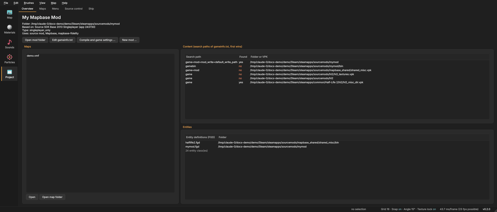

# The Project page
{: .no_toc }

The **Project** page in the side bar is about your mod as a whole: its maps, its main menu, its source code and how to
share it. It has eight tabs: **Overview**, **Features**, **Maps**, **Menu**, **Texts**, **Source control**, **Ship**
and **Build from source** (only for building the mod from its own code).

1. TOC
{:toc}

## Overview

What Mapsmith knows about the chosen game or mod:

- the **folder**, the game it is **based on**, its **type**, and what it uses (for example *source mod*);
- **Maps**: the `.vmf` files in the map folder. Double-click one (or **Open**) to edit it, **Open map folder** shows
  the folder;
- **Content (search paths of gameinfo.txt, first wins)**: every folder and VPK the game reads, in order, and whether it
  was **found**. A file in a path higher up hides the same file further down, which is how a mod replaces the game's
  files;
- **Entities**: the loaded FGD files and how many entity classes they define.
- **Game enhancements** (mods with mapbase-fidelity): the add-on's effects for the whole mod and what is left out;
  see [Game enhancements](mapbase-fidelity.html#game-enhancements).

Buttons: **Open mod folder**, **Edit gameinfo.txt**, **Compile and game settings ...** and **New mod ...**.

{: .tip }
If materials or models are missing in the editor, look at *Content* first: a search path marked *no* is a folder the
game will not find either.

## Maps

All maps of the mod in one list, with when each was **Changed** and **Compiled**, and the state of the **Last compile**
(*not compiled*, *up to date*, *outdated*, *failed*).

- **Open** (or a double-click), **New map ...**, **Duplicate**, **Rename ...** and **Delete** (moves the file to the
  trash). A map that is open in the editor cannot be renamed or deleted here.
- **Refresh** reads the map folder again.

### Batch compile

1. Tick the box in front of each map to compile, and press **Compile checked**. Or press **Compile all outdated**:
   every map that was never compiled, or was changed since its last compile.
2. The maps are compiled one after another with your [compile settings](compiling.html#the-compile-and-run-dialog).
   The game and cubemaps are left out between the maps, since both start the game.
3. **Run the game afterwards** starts the game with the last map that compiled.
4. **Cancel** stops after the running compile.

The Compile tab shows each map as it compiles. This is handy before a release: change a shared texture or prop, then
let all maps compile while you do something else.

## New mod

**File > New mod ...** (or the button on *Overview*) creates a new mod in Steam's `sourcemods` folder. First you choose
what it is based on - as big cards:

- **Half-Life 2 with Mapbase (recommended)**: Half-Life 2 and its episodes plus Mapbase - many more entities, better
  lighting, and Mapsmith's features installed right away. It needs Mapbase's shared content (`mapbase_shared` in
  `sourcemods`); without it the card says how to get it.
- **Half-Life 2 (plain)**: Source SDK Base 2013 Singleplayer, without Mapbase.
- **Multiplayer**: Half-Life 2: Deathmatch content (Source SDK Base 2013 Multiplayer).

Then the **Title** (shown in Steam and the main menu, e.g. *My Mod*) and the **Folder name** (letters, digits, `_` and
`-`, filled in from the title), and optionally the maps of the current game to take along.

**Create mod** writes the `gameinfo.txt`, the usual folders, a `cfg/autoexec.cfg` and the resource file with the title,
and opens the new mod in the editor. Restart Steam to see the mod in your library.

{: .note }
A mod built on Mapbase gets Mapbase's game code with Mapsmith's features at once (see [Features](#features-install-mapbase-fidelity-and-choose-what-it-does)).
**File > New project** goes one step further: the new mod plus a first map to build on (see the start page).

## Menu

The **Menu** tab edits what players see in your mod's main menu. On the left are the settings, on the right a
**Preview** (*As shown during a game (Resume, Save ...)* shows the in-game version). The preview is an approximation:
fonts and spacing come from the mod's scheme in the game.

### Title and logo

| Field | Saved as (in `gameinfo.txt`) |
|---|---|
| **Name** | `game`: the name in Steam |
| **Menu title**, **Second line** | `title`, `title2`: the text in the menu |
| **Show a logo image instead of the title text** | `gamelogo` (the logo comes from the mod's scheme) |
| **Window icon** | `icon`: a path without extension, e.g. `resource/icon` (a 32×32 `.tga`, and `_big.tga` at 256×256) |
| **Type**, **Developer**, **Website**, **Manual link** | `type`, `developer`, `developer_url`, `manual` |

Other keys and comments in `gameinfo.txt` stay exactly as they were.

### Chapters

The chapters of **New Game**. **+ Chapter** adds one. Each chapter has:

- **Title**: shown in New Game (saved in the mod's localization file, `resource/<mod>_english.txt` and so on);
- **Map**: the map it starts (saved as `cfg/chapterN.cfg`);
- **Background**: the map shown behind the main menu once players reached this chapter
  (`scripts/ChapterBackgrounds.txt`);
- **Earlier** / **Later** to reorder, and a button to remove it.

Without chapters, New Game has nothing to offer.

### Main menu

The entries of the menu (`resource/GameMenu.res`). **+ Entry** adds one. Each entry has:

- **Text (or #token)**: the label. A `#token` is looked up in the localization files; the result is shown;
- the **command**: pick a common one (New Game, Load Game, Options, Quit ...) or type `engine <console command>`, for
  example `engine map mymap` for an entry that starts a map;
- **Only in game** (shown only while a map is loaded), **Not in multiplayer**, **Not in singleplayer**;
- **Higher** / **Lower** to reorder, and a button to remove it.

If the mod has no `GameMenu.res` yet, the game's menu is shown, and saving gives the mod its own.

**Save to the mod** writes all changed files; **Reload** reads them again and drops what was not saved.

## Texts

The **Texts** tab edits the text files of your mod in `resource/`: its own texts (`<mod>_english.txt`: hints, signs,
entity messages, chapter titles) and its captions (`closecaption_english.txt`). Pick the file at the top; every
language the mod has (`<mod>_german.txt` and so on) is a column.

- **+ Token** adds a text. In the game you use it as `#Token` (menus, `env_message`, `game_text`, scripts).
  **Rename** and **Delete** act on every language at once.
- Click a cell to edit it in the table or in the field below. **+ Language ...** adds a translation; empty
  translations are marked red, **Only missing translations** shows just those rows.
- **Used by** tells which tokens the menu uses: chapter titles (`<MOD>_Chapter1_Title` ...) are the same ones the
  **Menu** tab edits, so a change in either tab shows in the other after saving.
- **+ File ...** starts a text or caption file if the mod has none yet.

### Captions

Captions are shown when a sound plays (subtitles with `cc_subtitles 1`, full captions with `closecaption 1`). The
token is the sound script entry (`NPC_Citizen.Hello`); **+ Caption for a sound ...** picks one from the game's sound
list. The buttons above the field insert the caption tags: **Colour ...** (`<clr:255,200,120>`), **Bold** (`<B>`),
**Italic** (`<I>`), **Line break** (`<cr>`), **Sound effect** (`<sfx>`: only shown with full captions) and
**Length ...** (`<len:3>`: seconds on screen). The dark box below shows how the line looks.

**Compile captions** saves and then writes `closecaption_<language>.dat` next to each `.txt` - the file the game
actually reads. You do not need Valve's captioncompiler.

**Save** writes the files as UTF-16, the way the game expects them; the first time a file is replaced, a copy
`<file>.bak` is kept. Comments and console-only lines (`[$X360]`) in the files stay as they were. Mapsmith only
writes into your mod's folder, never into the game's files.

## Source control

A simple front end for **git**, for a mod's source code or its content folder. Git must be installed (it is not part of
Mapsmith).

1. **Choose folder ...** picks the repository. In a folder that is not a repository yet, **Initialize a repository
   here** starts one.
2. The top line shows the branch and whether it follows a remote branch, with ↑ commits to push and ↓ commits to pull.
3. **Changes** lists every changed file with its state (*changed*, *added*, *deleted*, *renamed*, *new, not tracked
   yet*, *conflict*). Ticked files go into the next commit; double-click opens a file.
4. Write **What did you change? (commit message)** and press **Commit**. The commit is local.
5. **Push** sends your commits to the remote. **Pull** gets new commits and merges them. **Fetch** only asks what is
   new and changes nothing.

**History** lists the recent commits with their author and time. **Output** shows what git said.

Other buttons appear when they make sense: **Open on GitHub** (the repository's page), **Open in Visual Studio** (when
a `.sln` solution is in the folder) and **Update mod** (when the repository is the mod's source code, see
[Build from source](#build-from-source-advanced)).

{: .note }
Mapsmith only talks to the network through git, and only when you press Fetch, Pull or Push. Git uses your own
login; Mapsmith never sees a password.

## Features: install mapbase-fidelity and choose what it does

### Install

Mapsmith brings mapbase-fidelity ready-built – the mod's graphics and sound add-on: ambient occlusion, light shafts,
the sound mixer, liquid in bottles and more. **Install features** (on the **Features** tab, right after *Overview*)
puts it into the open mod with one click:

- the game code: `bin/client.dll` and `bin/server.dll` (Mapbase with the add-on, for Half-Life 2 or Episode Two mods –
  Mapsmith reads which one from the mod's `gameinfo.txt`) and the add-on's shaders (`bin/game_shader_dx6.dll`,
  `shaders/fxc`);
- its settings (`cfg/fidelity.cfg`, run from `autoexec.cfg`);
- VRAD with baked ambient occlusion, into the compile tools' folder (Source SDK Base 2013 Singleplayer's `bin`), so
  your map compiles bake it;
- then the generated materials (liquid in bottles, sheen, relief ...), made from the game's own.

The **Install** card lists these files with one line each and shows the state in colour: green **Installed** with
the version and the date, orange **Not installed** or **Update available**. While it installs, a bar shows the two
steps (copying, then making the materials) with the time it takes. No compiler, no git, no scripts to start. A Mapbase mod without the features shows a line **Give this mod Mapsmith's
features** on the Overview with the same button, and a **New mod** with Mapbase gets them right away.

What the mod had before (Mapbase's own DLLs, for example) is kept as `<file>.mapsmith-backup` and comes back with
**Remove features**. `cfg/mapsmith_installed.txt` in the mod lists what Mapsmith put there, so an update replaces only
its own files and never yours.

**Updates come by themselves:** when a newer Mapsmith brings newer features, the mod gets them the next time you open
it (switch *Update the mod's features by themselves ...* off to do it by hand with **Update features**).

{: .important }
The ready-built features come with the Windows version of Mapsmith (the installer and the ZIP from the releases).
A copy you built yourself has none; the tab says so.

### Choose what it does

The checklist below the install is everything mapbase-fidelity can do in the mod,
grouped into *Graphics* (ambient occlusion, light shafts, light in the air, sun shadows, drifting clouds, FXAA, ...),
*Effects* (glowing things light the room, muzzle flash light, impact dust, blood pools, weapon sway, ...), *Sound*
(the mixer, sounds behind walls, room reverb, distant shots, ...) and *Materials* (liquid in bottles, swaying plants,
water with sun glint and foam, walls with depth). Each has a line saying what the player sees or hears.

Everything is on. Untick what the mod should not have – it is switched off for everyone who plays the mod. A tick is
saved at once and the game uses it from its next start:

- the graphics, effect and sound switches go into `cfg/mapsmith_features.cfg`, which the game runs from `autoexec.cfg`
  when it starts (a player can still change a switch in the console until the next start);
- the material features are the [Game enhancements](mapbase-fidelity.html#game-enhancements): unticking *Liquid in
  bottles* is the same as switching that enhancement off on the Overview.

The first time you open a mod that has mapbase-fidelity, the Overview shows a line **Choose this mod's features** with
**Choose features** (opens this tab) and **Keep all on** – once; after that the tab is always there to change them.
A **New mod** can get its features right away too (*Choose features ...* in the dialog): they wait in the mod and are
used as soon as mapbase-fidelity is installed there.

### Fresh install

When something got mixed up, **Fresh install ...** starts mapbase-fidelity over in the mod:

1. It first **lists** everything the add-on and Mapsmith made in the mod – generated materials, height maps and bump
   maps, model copies, the add-on's shaders, its `fidelity.cfg` and shader DLL – and nothing else: your own maps,
   materials and files are never in the list. Nothing happens until you press **Remove and install again**.
2. It **removes** them (what was there before the install comes back).
3. It **writes the features** of the checklist again.
4. It **installs the features again** (with *Build the game code from the mod's own source* – shown only when you
   build the mod yourself – it builds from source instead).

The steps tick off on the tab; *Show details* opens the Build from source tab with the full output.

### Make report

Something looks wrong in the game – a wall, an effect, a sound? In the game, stand where it happens,
open the console and type `fidelity_report`. Close the game and press **Make report**: Mapsmith packs what it wrote
into `fidelity_report.zip` and opens its folder, ready to send. The button is where you look after testing a map:
*Map › Make report from the game*, the **Compile** panel (after a run) and the **Problems** panel. It works for every
mod with the features – no source code needed; the run shows on the Build from source tab.

## Build from source (advanced)

**You do not need this tab to get the features** – [Features](#features-install-mapbase-fidelity-and-choose-what-it-does)
installs them. It is for people who change and build the mod's code themselves: if your mod is built from its own
source code – a Mapbase checkout with mapbase-fidelity, which has `update.bat`, `deploy.bat` and `report.bat` – the
**Build from source** tab (the last one) does what those scripts do, inside Mapsmith: in the background, without a
console window and without "Press any key". Without a checkout, its **Install features** button does what the
Features tab does.

**Source code of the mod.** Mapsmith looks for the checkout by itself: in the Source control folder of this mod (and
the folder it is in), in `Documents\GitHub`, `source\repos` and similar folders in your home folder, and in folders
like `GitHub` or `repos` at the top of each drive – a folder named like the mod first. If it finds nothing, press
**Choose folder ...** and pick the folder that has `fidelity` and `sp` in it. The choice is remembered for this mod.

**Update mod** runs the checkout's `fidelity/update.ps1` for the open mod. You see its steps tick off – *Find Visual
Studio 2022*, *Project files*, *Build game code*, *Copy DLLs into the mod*, *VRAD with baked AO*, *Game files* and
*Done* – with a progress bar and the full output below. **Cancel** stops the script and the build it started. At the
end a summary says how it went; when something failed it names the step and what to do, for example:

- *Visual Studio 2022 was not found* – install it (the free Community edition is enough) with the workload *Desktop
  development with C++*, then press Update mod again.
- *The game code did not compile* – the first errors are listed; the whole build log is `fidelity/update.log` in the
  source folder.
- *The game is still running* / *Hammer or a map compile is still running* – close it and try again.

After a successful update Mapsmith reads the mod again (new shaders, materials and game enhancements show up in the
views right away); the open map stays open.

**Skip VRAD** leaves the custom VRAD out (faster; map compiles then bake no ambient occlusion). **Install game files
only** runs `deploy.ps1` (shaders, cfg, generated materials – no build). **Make report** runs `report.ps1`: it packs
what `fidelity_report` wrote in the game into `fidelity_report.zip` and opens its folder, ready to send.

**Automatic** (per mod, all off until you switch them on):

- **Update the mod after every Pull that brings new code** – a Pull in Source control (or **Pull & update** here)
  runs Update mod by itself.
- **Look for new commits when Mapsmith starts** – runs `git fetch`; the Overview tab then shows "N new changes in the
  mod's code" with a **Pull & update** button.
- **Pull and update automatically when Mapsmith starts** – gets the new commits and updates the mod as soon as the mod
  is opened.

Without any of these, the Overview still tells you when the checkout changed since its last update (for example after
a pull with another program), and offers **Update mod**.

{: .important }
Building the mod's DLLs needs **Windows with Visual Studio 2022** installed (workload *Desktop development with C++*).
On Linux and macOS the build is not possible; Install game files only and Make report work there when PowerShell 7
(`pwsh`) is installed.

{: .note }
Mapsmith uses your own git for this and only contacts the remote when one of the automatic options is on or you press
Check now, Pull & update or Pull.

## Ship

The **Ship** tab gets a map or the whole mod ready for other people.

### Share this map

1. **Compiled map**: the map's `.bsp` (compile it first). **Browse ...** picks another.
2. **Check what the map needs** lists every file the map uses: materials, textures, models, sounds, particles,
   soundscapes, detail sprites. They are grouped:
   - **Your mod**: players do not have these; they must go into the BSP or the ZIP.
   - **Missing**: nobody has these; the game shows a checkerboard, an error model or silence. Fix these first.
   - **Other mod folders**: from shared content outside the installed games; players need them too.
   - **Base game**: players already have these.
3. Then either:
   - **Pack into BSP**: puts your mod's own files into the `.bsp` itself (with the game's `bspzip`), so the one file is
     enough; or
   - **Make share ZIP ...**: `maps/<name>.bsp` with your mod's files next to it, ready to unpack into a game folder.
     The **Readme for players** goes into the ZIP as `readme.txt`.

### Share the mod

**Check mod folder** lists what would go into a ZIP of the whole mod and what **Stays out**, with **Why**: map
sources (`.vmf`, `mapsrc`), material and model sources, saved games, screenshots, logs, compile leftovers (`.prt`,
`.lin`), version control, your own `cfg/config.cfg` and system files. **Make mod ZIP ...** writes it.

### Steam Workshop (advanced)

**Show upload settings** opens the Workshop form, for games with a Workshop:

- **Game (app id)** (Half-Life 2 is 220), **Item id** (empty for a new item), **Title**, **Description**, **Change
  note**, **Preview image** (JPG or PNG under 1 MB) and **Visibility** (*Public*, *Friends only*, *Private*,
  *Unlisted*);
- **steamcmd**: the path of Valve's command line tool, and your **Steam account** name.

**Prepare upload** builds the content folder from the share package and writes the item file. **Run steamcmd** starts
the upload; steamcmd asks for your login itself. The command is shown, with **Copy**, if you prefer to run it yourself.
