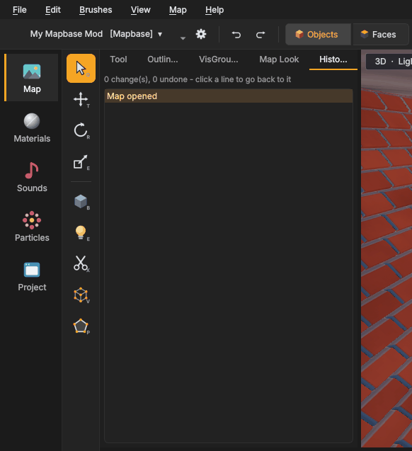

# Safety and search
{: .no_toc }

Mapsmith tries hard never to lose your work, and to help you find things in big maps.

1. TOC
{:toc}

## History

Every change to the map is one step in the undo history: **Ctrl+Z** undoes, **Ctrl+Y** (or Ctrl+Shift+Z) redoes.
The **History** tab of the left panel shows every step with its name, such as *Move*, *Hollow* or *Set key*.

- **Click** a line to go back to that point. Everything after it is shown greyed out.
- Click a later line to go forward again.
- Make a new change while you are back in the history, and the greyed-out steps are dropped, as with undo.

The line at the top says how many changes there are and how many are undone. The history keeps the last 500 steps
and starts fresh when you open a map.

Changes that are not part of the map, such as cordons, the camera or hidden objects, are not in the history.

## Autosave and recovery

**Autosave.** Every 5 minutes, if the map changed, Mapsmith writes a copy into a folder named `autosave` next to the
map: `<map>.<date>-<time>.vmf`. The newest 10 copies are kept. A map that was never saved is autosaved into Mapsmith's
own data folder. Writing happens in the background, so the editor does not pause.

**After a crash.** When Mapsmith did not close normally, or when you open a map whose autosaves are newer than the
file, it asks **Restore an autosave?** and lists the copies with their time:

- **Restore selected** opens the chosen copy. Save it to make it the map again.
- **Open the file as it is** ignores the autosaves.

**One step back on disk.** Every time you save, the previous version of the map is kept as `<map>.vmx` next to it. To
use it, rename it to `.vmf` (or copy it to a new name) and open it.

**Unsaved changes.** Closing the window, opening another map or starting a new one asks whether to save first.

## Find entities

**Edit > Find entities ...** (Ctrl+F) has two tabs.

### Find

Pick what to search in the list on the left, **Anything**, **Class**, **Name**, **Key = value**, **Output target**,
**Model** or **Sound**, and type. The results appear while you type.

With *Anything*, you can combine terms; all of them must match:

| Term | Finds |
|---|---|
| `door` | entities whose class, name, model or any value contains *door* |
| `class:prop_*` | only by class; `*` matches any text, `?` one character |
| `name:relay_*` | only by name |
| `rendercolor=255*` | entities whose key has that value |
| `target:relay_*` | entities with an output that fires at that name |
| `model:barrel` · `sound:alarm` | only by model, only by sound keys |

Example: `class:light* _light=255 255 255*` finds every white light.

Clicking a result selects it in the map. **Select all** selects every result, **Go to** selects the marked results
and moves the camera to them. Double-click a result to go to it.

### Entity report

Every entity of the map in one table with its **Class**, **Name**, **Origin**, number of **Outputs** and **Id**. Pick
a class in the list (or *All classes*), or type in **Filter by class, name or any value ...**. Click a column title to
sort. Double-click goes to the entity.

**Edit > Entity report ...** opens the dialog on this tab.

## Replace materials

**Edit > Replace materials ...** (Ctrl+Alt+R) swaps one material for another.

| Field | Meaning |
|---|---|
| **Find** | the material to replace. **Current material** fills in the one picked in the browser |
| **Replace with** | the new material |
| **Whole map** / **Only the selection** | where to replace |
| **Wildcards in Find (* and ?, e.g. concrete/*)** | replace a whole group at once |
| **Keep the texture alignment** | keep scale, shift and rotation of each face. Off: the new material is aligned to the world at its normal size |
| **Also overlays and decals** | also change `info_overlay` and `infodecal` entities |

**Replace** changes everything in one undo step and says how many faces it changed.

## Other ways to find things

- **Outliner** tab (left panel): every object by class, with a filter. Click to select.
- **Go to ID ...** (Ctrl+Shift+G): select a brush or entity by its number, as named in compile errors.
- **Select similar** (Ctrl+Alt+O): select everything like the selection.
- **Used in this map** in the Asset Browser: every material the map uses; on the *Models* tab (and the Models page)
  every model the map uses, with how often (`crate01 · 3×`).
- The [Problems](compiling.html#problems-and-leaks) tab: **Select** on any problem selects the objects concerned.

## Export for other programs

**File > Export for other programs ...** (Ctrl+Alt+E) writes the map as **glTF** or **OBJ**, with its brushes, props
and textures, for use in a 3D program, for renders or for blocking out in another tool. It is a one-way copy: Mapsmith
cannot read these files back as a map.
