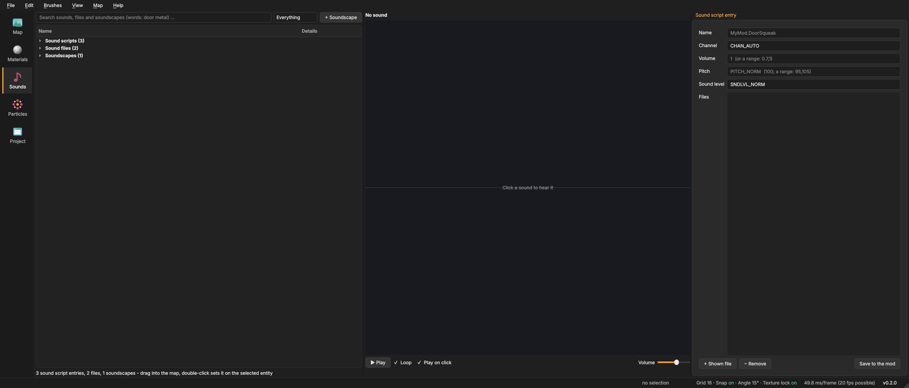
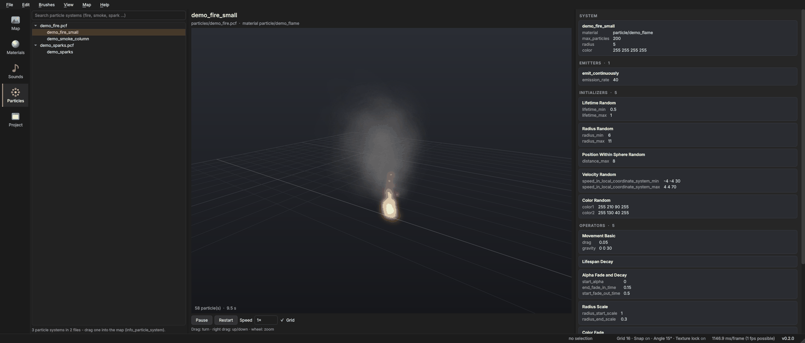

# Sounds, soundscapes and particles
{: .no_toc }

1. TOC
{:toc}

## The Sounds page

The **Sounds** page (side bar) and the **Sounds** tab of the bottom panel show the same browser. On the page there is
more room; in the bottom panel you can drag sounds into the map while you build.

On the left is the list of **categories**: *Weapons*, *NPCs and creatures*, *Ambient*, *Physics and impacts*,
*Player*, *Vehicles*, *Doors and buttons*, *Music*, *Interface*, *Voice and dialogue* and *Other*, each with the number
of sounds, plus *All sounds* and *Soundscapes*. Mapsmith sorts by the folders (`weapons/`, `npc/`, `vo/` ...) and by
the names of sound script entries (`Weapon_Pistol.Single`, `Wood.ImpactHard`).

Next to it the tree shows the chosen category by folder. In each folder come first the **sound scripts** (orange: named
entries like `Doors.Squeak` from `scripts/game_sounds_*.txt`, which most entities want) and then the **sound files**
(`.wav`, `.mp3`, `.ogg` below `sound/`). A script sits in the folder of its first file, so `Weapon_Pistol.Single` is
right next to `weapons/pistol/pistol_fire2.wav`. Open a script to see its files.

Type in **Search all sounds and soundscapes (words: door metal) ...** to search every category at once; the list
next to it shows only scripts or only files.

### Listening

- **Click** a sound to see its waveform and, with **Play on click**, hear it.
- **▶ Play** plays or stops (Space). **Loop** repeats it.
- Click into the waveform to play from there. A sound's loop point (from its cue marker) is shown.
- The **Volume** slider goes down very quiet; it is in decibels, so each step sounds equally big.

Mapsmith plays WAV (including ADPCM), MP3 and OGG files itself.

### Using sounds in the map

- **Drag** a sound script or sound file into the 3D view: it becomes an `ambient_generic` playing that sound.
- **Drag** a soundscape into the view: it becomes an `env_soundscape` with that soundscape.
- **Double-click** sets the sound on the selected entity.
- **Ctrl+C** copies the name; Ctrl+V pastes it into any field.

### Importing your own sounds

**Import ...** next to the search box (or *File › Import into the mod › Sound ...*) brings a WAV, MP3, OGG or FLAC
file into the mod as a WAV the game plays (16 bit; Source cannot play OGG or FLAC itself):

- **Folder** and **Name**: it goes to `sound/<folder>/<name>.wav` (letters, digits, `_` and `-` only).
- **Quality**: 44100 Hz, 22050 Hz (half the size) or 11025 Hz. **Channels**: mono for sounds that come from a place
  in the world, stereo for music and sounds that are everywhere. **Normalize** makes it as loud as possible.
- **Loops in the game**: for hums, machines and rain played by an `ambient_generic` (the file gets a loop point).
- **Sound script entry**: a name like `Custom.Hum` with volume, pitch and how far it is heard; it goes into
  `scripts/game_sounds_mapsmith.txt`, which is added to the mod's sound list (the game's own list is copied first, so
  no sound of the game goes missing).
- **Use a sample ...** opens Mapsmith's sample sounds (a loop, an Ogg, an MP3, a FLAC - see *Getting started*).
- **▶ Listen** plays it as it will be imported. **Goes to** shows where; if something with that name exists,
  **Replace** must be ticked. After importing, **Undo import** takes it back.

### Editing a sound

Below the waveform are the edit tools. They work on the **selection** - drag across the waveform to select a part
(Shift+drag changes it) - or on the whole sound when nothing is selected. The line above the tools shows what is
selected.

| Tool | What it does |
|---|---|
| **Trim to selection** | keeps only the selected part |
| **Cut** | removes the selected part |
| **Silence** | makes the selected part silent |
| **Fade in** / **Fade out** | over the selection; without one over the first / last tenth |
| **Normalize** | as loud as possible without clipping (peak at -1 dB) |
| **Reverse** | backwards |
| **Gain** | louder or quieter by the decibels next to it (6 dB is twice as loud) |
| **Speed** | faster and higher above 100 %, slower and lower below, like a tape |
| **Sample rate ...** | 44100, 22050 or 11025 Hz, the rates the Source engine plays well |
| **Mono** | one channel; sounds placed in the world should be mono |
| **Loop from here** / **No loop** | the game repeats the sound from the selection's start to the end, or plays it once |

**▶ Selection** plays only the selected part. **↶ Undo**, **↷ Redo** and **Revert** step through your edits of this
sound; *● edited* next to its name means there are unsaved changes.

**Save WAV to the mod** writes the result as a 16-bit WAV below the mod's `sound/` folder, at the path in **Save as
sound/**. It suggests the path of the sound you opened: a file there replaces the game's sound in your mod. Mapsmith
never writes into the game's own folders; replacing a file your mod already has asks first. With **+ sound script
entry** the file also goes into the sound script entry on the right, which is saved with it (give it a name first, or
Mapsmith makes one from the mod and file name).

### Sound script entries

Selecting a sound script entry shows its settings on the right:

| Field | Meaning |
|---|---|
| **Name** | the entry's name, e.g. `MyMod.DoorSqueak` |
| **Channel** | which sound channel (CHAN_AUTO, CHAN_WEAPON, CHAN_VOICE ...) |
| **Volume** | 0 to 1, or a range like `0.7,1` for a random volume each time |
| **Pitch** | 100 is normal; a range like `95,105` varies it |
| **Sound level** | how far it carries (SNDLVL_NORM, SNDLVL_80dB ...) |
| **Files** | one or more sound files; with several, the game picks one at random |

**+ Shown file** adds the sound shown in the player, **− Remove** removes the marked file. **Save to the mod** writes
the entry into `scripts/game_sounds_<mod>.txt` and adds that file to the mod's `game_sounds_manifest.txt`. Entries from
the game are saved as a changed copy in your mod.

## Soundscapes

A soundscape is the ambient sound of an area: wind outside, a hum in a factory, drips in a cave. An `env_soundscape`
entity in the map says *where* a soundscape plays; the soundscape itself says *what* plays.

Click a soundscape in the tree, or press **+ Soundscape** for a new one. The editor on the right shows:

| Field | Meaning |
|---|---|
| **Name** | the name the `env_soundscape` uses in its *soundscape* key, e.g. `mymod.cave_drips` |
| **Room effect** | the echo while it plays (the engine's DSP presets, with names like *Concrete, small*) |
| **Fade in** | seconds to fade in; empty means the engine's default |

Below are its **sounds**, one card each:

- **+ Looping**: a sound that plays all the time (wind, hum). *Sound*, *Volume*, *Pitch*, *Sound level*, *Position*.
- **+ Random**: one of several sounds every few seconds (birds, creaks). A list of *Sounds* and *Every* (seconds,
  `5,10` means between 5 and 10).
- **+ Soundscape**: plays another soundscape inside this one, e.g. a shared "city background". *Volume* and
  *Position*.

On each card: **▶** listens to it, **↑** moves it up, **✕** removes it. *Use shown* or *+ Shown* takes the sound shown
in the player. Typing a sound file name completes it.

*Position* empty means the sound is everywhere around the player. A number from 0 to 7 makes it come from the
`env_soundscape`'s position target of that number, so it sounds like it comes from a place.

**Save to the mod** writes `scripts/soundscapes_<mod>.txt` and puts it **first** in the mod's
`soundscapes_manifest.txt`. A changed copy of a game soundscape is therefore used instead of the original. **Delete**
removes a soundscape from the mod's own file. Keys the editor does not know stay in the file.

To decide *where* a soundscape plays (a sphere or a block), see
[Soundscapes in the map](entities.html#soundscapes).

### How the game picks a soundscape

The player hears the soundscape of the nearest `env_soundscape` that the player can see and whose radius they are in.
A `trigger_soundscape` switches to its soundscape while the player touches it. If no soundscape applies, the last
one keeps playing. Put an `env_soundscape` into every distinct area, and one with a calm default near the start.

## Particles

The **Particles** page shows the game's particle systems, from the `.pcf` files in `particles/`.

- On the left, the systems grouped by file, with a search field.
- In the middle, a **moving preview**. Drag with the left button to turn around it, with the right button to move up
  and down; the wheel zooms. **Pause**, **Restart**, **Speed** (0.25× to 2×) and **Grid** control it.
- On the right, the system's parts as cards: the system itself, **Emitters**, **Initializers**, **Operators**,
  **Renderers** and **Children**, each with all its values. **Show** on a child opens it.

The preview simulates the common parts: emitting, lifetime, size, colour and alpha, movement with gravity and drag,
fading, scaling and rotation, with the system's sprite material; additive materials glow. It is close to the game, not
exact: parts it does not know are listed but have no effect, and sprite-sheet animation is not played.

**Import ...** next to the search box brings a particle file (`.pcf`, made with the game's particle editor or taken
from another mod) into `particles/` and lists it in `particles/particles_manifest.txt` (made from the game's list if
the mod has none). **Load with every map** puts a `!` in front, which effects started by code need. The dialog lists
the systems in the file; files without any are refused. **Use a sample ...** opens Mapsmith's sample particle file
(`mapsmith_samples.pcf`: falling sparks and a slow smoke column).

**Drag** a system into the map (from the page or the bottom panel's *Particles* tab) for an `info_particle_system`
that plays it. In the map views, particle effects are not drawn; they only show in the game.

{: .note }
A custom `.pcf` file must be listed in the mod's `particles/particles_manifest.txt`, or the game does not load it.
