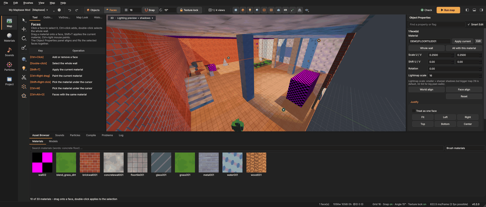
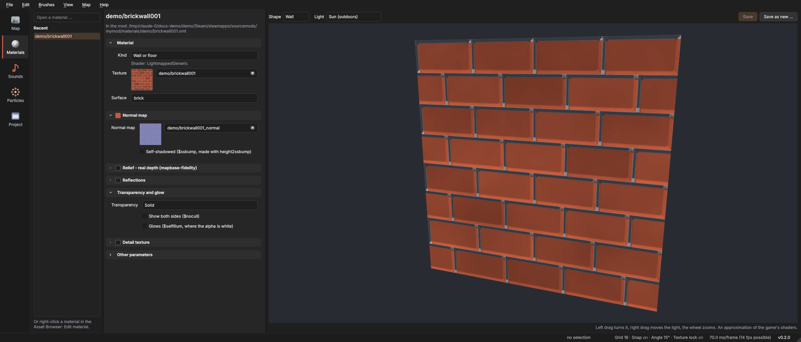

# Texturing and materials
{: .no_toc }

In Source, a **material** (`.vmt`) says how a surface looks: which **texture** (`.vtf`) it uses, its normal map, its
reflections, whether it is see-through, what it sounds like when you walk on it. Every face of a brush has one material.

1. TOC
{:toc}

## The Asset Browser

The **Asset Browser** at the bottom has two tabs, **Materials** and **Models**.

- Type in the search field. Several words all have to match, e.g. `concrete floor`.
- The list next to it filters by kind: **Brush materials**, **Blend (displacements)**, **Model materials**, **Tool
  textures**, **See-through (glass, fences)**, **Water**, **Decals / overlays**, **Skybox**, **Used in this map** and
  **All**.
- **Click** a material to make it the **current material**. New blocks get it, and Shift+T applies it.
- **Drag** a material onto a face in the 3D view to put it there.
- **Double-click** applies it to the selection.
- **Right-click** a material: **Edit material ...** opens it in the Material Editor, **Copy name** copies its name.
- **Ctrl+C** on a material copies its name; Ctrl+V pastes it into any field.

## Applying materials

| How | What happens |
|---|---|
| **Shift+T** | the current material goes on every face of the selected brushes (in face mode: on the selected faces) |
| drag from the browser | the material goes on the face under the mouse |
| **Ctrl + right mouse drag** | paints the current material on every face the cursor passes; one undo step per stroke |
| **Shift + right click**, or **Ctrl+M** | picks the material of the face under the cursor and makes it current |
| **Alt + click** in face mode | also picks the material under the cursor |

## Faces mode

Press **3** (or click **Faces** in the top bar) to select single faces instead of whole brushes. Press **5** to go back
to objects.

- **Click** a face to select it, **Ctrl+click** adds or removes one.
- **Double-click** selects the **whole wall**: every face that lies in the same plane and touches this one.
- **Select similar** (Ctrl+Alt+O) selects every face with the same material.

The right panel then shows:

| Field or button | What it does |
|---|---|
| **Material** with **Apply current** and **Edit** | the face's material; *Edit* opens it in the Material Editor |
| **Whole wall**, **All with this material** | grow the selection |
| **Scale U / V** | texture size; 0.25 is the usual value (one texture pixel = a quarter unit) |
| **Shift U / V** | moves the texture along the face |
| **Rotation** | turns the texture |
| **Lightmap scale** | detail of the baked light; smaller means sharper shadows but a bigger map. 16 is the default; 32–64 for big plain walls |
| **World align**, **Face align**, **Reset** | how the texture is laid on the face |

### Justify

The **Justify** box lines the texture up with the face's edges: **Fit**, **Left**, **Right**, **Top**, **Bottom**,
**Center**. Tick **Treat as one face** to justify several selected faces as one: one texture spans all of them and
fits seamlessly where they meet. This is useful for a long wall made of several brushes.

### Texture lock

With **Texture lock** on (top bar), textures stay glued to the faces when you move, rotate or scale. Turn it off when
you want the texture to stay in place while the brush moves, for example to line up a pattern.

Scaling with texture lock keeps the texture size: the texture is not stretched with the brush.

## The Material Editor

The **Materials** page in the side bar is the Material Editor. Open a material by:

- right-clicking it in the Asset Browser, **Edit material ...**;
- clicking **Edit** next to a selected face's material;
- **View > Material Editor**;
- typing its name in **Open a material ...** on the left. *Recent* lists the materials you edited lately.

The middle column shows the material's parameters in groups. The **Kind** at the top decides which groups make sense:

| Kind | Shader | For |
|---|---|---|
| **Wall or floor** | LightmappedGeneric | brushes |
| **Blended ground (two textures, displacements)** | WorldVertexTransition | displacements that blend two textures |
| **Model** | VertexLitGeneric | props and NPCs |
| **Without light (screens, signs)** | UnlitGeneric | things that should not be lit |
| **Water** | Water | water surfaces |

The groups:

- **Material**: the kind, the **Texture** (`$basetexture`), the **Second texture** for blends, and the **Surface**
  (footsteps, bullet impacts and physics, from `scripts/surfaceproperties.txt`).
- **Normal map**: the bump map; *Self-shadowed* for `$ssbump` textures.
- **Relief - real depth (mapbase-fidelity)**: see below.
- **Reflections**: what the surface reflects (*The nearest env_cubemap* or *A cubemap texture of its own*), how
  strongly (*Strength / colour*), and *Where* (everywhere, a mask texture, the texture's alpha or the normal map's
  alpha).
- **Transparency and glow**: *Solid*, *See-through (glass, smoke)*, *Cut out (fences, leaves)* or *Glowing, adds
  light (beams)*; *Show both sides*; *Glows* (`$selfillum`).
- **Detail texture**: a second, fine texture over the main one, with *Size* and *Blend*.
- **Shiny highlights ($phong)**: for models; size and strength of the highlight.
- **Water**: waves, reflection and refraction colours and strengths, the colour in the depth, *Clear down to* and
  *Opaque from*.
- **Other parameters**: every other `$parameter`, as a table you can add to.

A group with a switch in its title is a **feature**: turn it off and the group folds away. Turning it on again brings
its values back.

Texture fields show a small picture of the texture. **Pick ...** opens a browser.

On the right is a **live preview**. Choose the *Shape* (Wall, Cube, Sphere) and the *Light* (Sun, Lamp, Night, Unlit).
Drag with the left mouse button to turn it, with the right button to move the light, and use the wheel to zoom. The
preview is an approximation of the game's shaders, not an exact match.

### Saving

- **Save** writes the `.vmt` into your mod. A material that comes from the game's VPK files becomes an override copy
  in the mod, which then replaces the game's.
- **Save as new ...** asks for a new name below `materials/`, e.g. `mymod/walls/brick_dark`.
- The line under the title says where the material comes from and where *Save* will write it.

## mapbase-fidelity materials

If your mod uses the [mapbase-fidelity](mapbase-fidelity.html) graphics add-on, the Material Editor can turn on its
shaders. The preview shows them right away; the game shows them after the mod's `deploy.bat` has run once.

### Relief (real depth)

Turn on the switch in the header of the **Relief - real depth (mapbase-fidelity)** group. Walls become `Fidelity_Parallax`, blended ground
becomes `Fidelity_WorldVertexTransition`. Stones, joints and grooves then really go into the wall and hide each other at
an angle.

| Setting | Meaning |
|---|---|
| **Depth** | how deep the relief goes |
| **Darker in the depths** | shading in the grooves |
| **Fades out from** | distance after which the surface is flat again (saves performance) |
| **Height map** | where the depth comes from: **From the normal map** or **From the texture** (bright parts high, dark joints low) |
| **Upside down** | swaps high and low |
| **Paint zones ...** | paint where the surface stays flat (blue) or is turned upside down (orange) |

Saving writes `<material>_relief.vtf` next to the material.

In the map views, the lighting preview shows the relief on walls automatically when the mapbase-fidelity look is on
(view menu), using the same rules as the add-on's `deploy.bat`.

### Water

In a Water material, the switch of the **Sun glint and shore foam (mapbase-fidelity)** group turns it into
`Water_Fidelity`, with sliders for *Glint* and *Foam*.

### Liquid inside a glass

For bottles, jars and jugs (model materials): the switch of the **Liquid inside a glass (mapbase-fidelity)** group
makes the material `Fidelity_Liquid`. Set the
liquid and glass colour and opacity, the *Fill level* (*Different in every prop* or *Always the same*), how much it
*Sways*, its *Thickness*, and whether it *Splashes when the prop breaks* or pours out when tipped over.

A material that `deploy.bat` generated is marked as such. Saving it in the editor makes it the mod's own, and
`deploy.bat` leaves it alone from then on.

## Tips

- Keep texture scale 0.25 on world brushes unless you have a reason. Very small scales make blurry textures, and
  mixing scales makes seams visible.
- Use `tools/toolsnodraw` on faces the player can never see (backs of walls, under floors). It saves rendering and
  compile time. See [Source mapping basics](mapping-basics.html#nodraw-and-tool-textures).
- Faces with `tools/toolsskybox` show the map's sky in the 3D view, as in the game.
- Use **Used in this map** in the browser to see every material the map uses, and
  [Replace materials](safety-search.html#replace-materials) to swap one for another everywhere.
